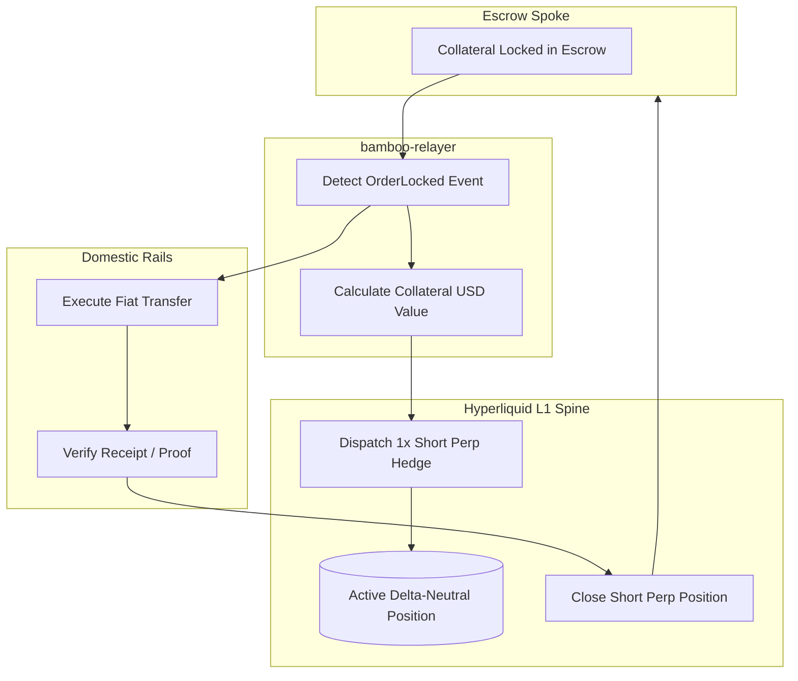

<!-- OPENWIKI:START -->
# Hyperliquid Delta-Neutral Clearing Spine

During cross-chain fiat off-ramping, an off-chain fiat settlement window occurs between the time crypto collateral is locked in an escrow spoke (Base, Solana, or BNB Chain) and the time fiat arrives in the recipient's bank account. This window typically lasts anywhere from a few seconds (Pix, M-Pesa) to minutes (SEPA Instant).

If volatile tokens (e.g., SOL, BNB, ETH) are deposited as collateral, downward price movements during this settlement window could cause relayer losses or under-collateralized payouts.

Project Bamboo solves this by deploying **`bamboo-hedging`**, a dedicated sub-engine that dispatches automated **1x short perps/spot hedges on Hyperliquid L1 order books**.

---

## Hedging Mechanics

1. **Leverage Calibration**:
   The engine enforces strict **1x leverage** (`default_leverage: 1`). This is purely delta-neutral risk mitigation, eliminating liquidation risk while exactly offsetting collateral price fluctuations:
   $$\Delta_{\text{net}} = \Delta_{\text{collateral}} + \Delta_{\text{short}} = (+1) + (-1) = 0$$

2. **Order Book Execution**:
   Orders are dispatched to Hyperliquid L1's low-latency CLOB (Central Limit Order Book) via signed EIP-712 messages over WebSocket/REST endpoints.

3. **Position Lifecycle**:
   * **`open_collateral_hedge`**: Triggered when `OrderLocked` is parsed from on-chain logs.
   * **`close_collateral_hedge`**: Triggered when either:
     - The domestic fiat rails confirm successful payout (`OrderSettled`), or
     - The escrow expires and a timelock refund is initiated (`OrderRefunded`).

---

## Code Reference
Implemented in [`crates/bamboo-hedging/src/lib.rs`](../../crates/bamboo-hedging/src/lib.rs) via `HyperliquidHedgeEngine` and `HedgePosition`.
<!-- OPENWIKI:END -->
