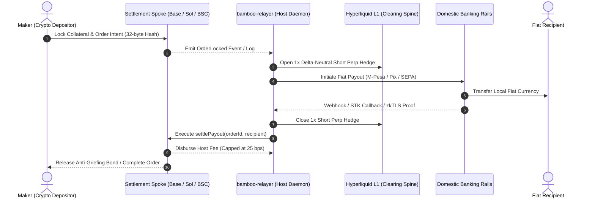

<!-- OPENWIKI:START -->
# Project Bamboo – System Architecture & Three-Spoke Protocol

> [!NOTE]
> **Status: v1 differs — see [docs/plan/](../plan/00-overview.md)**  
> Bamboo v1 is implemented as a single-chain, single-rail vertical slice: Solana USDC to Safaricom M-Pesa KES via a single reference relayer. The Three-Spoke architecture (Base Uniswap v4, BSC escrow) and Hyperliquid delta-neutral hedging are part of the long-term roadmap. See [00-overview.md](../plan/00-overview.md).

Project Bamboo is a non-custodial, cross-chain fiat settlement engine that enables trustless, low-friction off-ramping directly from decentralized liquidity pools and native escrows into domestic banking rails.

Settlement operates across three distinct execution spokes:
1. **Base (Uniswap v4 Hook)** – EVM hook capturing swap deltas via transient storage.
2. **Solana (Anchor SVM Escrow)** – Program Derived Address escrow with anti-griefing micro-bonds.
3. **BNB Smart Chain (Native BEP-20 & BNB Escrow)** – High-velocity retail P2P off-ramping without cross-chain bridge wrapping.

---

## Protocol Invariants

### 1. Protocol Fee Ceiling
To protect users and maintain algorithmic determinism across all spokes, relayer fees are strictly capped:
* **Host Fee Ceiling**: `MAX_HOST_FEE_BPS = 25` (0.25% protocol maximum).
* Enforced on-chain across both EVM contracts and Anchor program, as well as validated inside `bamboo-core` and the `bamboo-relayer` API.
* Any order submitted with `host_fee_bps > 25` reverts unconditionally with `HostFeeCeilingExceeded`.

### 2. Canonical 32-Byte Domain Identifiers
Every order across Base, Solana, and BNB Chain is uniquely keyed by a canonical 32-byte identifier:
$$\text{order\_id} = \text{SHA256}("BAMBOO\_V1\_ORDER" \parallel \text{chain} \parallel \text{maker} \parallel \text{token} \parallel \text{amount} \parallel \text{fiat\_hash} \parallel \text{nonce})$$

Similarly, fiat recipient identifiers (IBANs, PIX keys, M-Pesa phone numbers) are masked using salt:
$$\text{fiat\_recipient\_hash} = \text{SHA256}("BAMBOO\_FIAT\_V1" \parallel \text{recipient\_id} \parallel \text{salt})$$

This preserves privacy on public ledgers while enabling committed relayers to mathematically verify recipient claims off-chain.

### 3. Delta-Neutral Clearing Spine
During the fiat verification window (which typically spans 30 seconds to several minutes depending on banking settlement), market volatility can erode collateral value. Project Bamboo mitigates this by streaming orders into `bamboo-hedging`, which opens an automated **1x short perp position on Hyperliquid L1 order books**. Once fiat settlement is attested or the order refunds, the hedge is closed.

---

## Phased Rollout Strategy

| Phase | Milestone | Deliverables |
|---|---|---|
| **Phase 1 (MVP)** | Base Hook, Solana Escrow, Axum Quoter | Stand up Base hook, Solana escrow, core schema, and basic Axum quoter |
| **Phase 2 (Hardening)** | Delta-Neutral Spine & Domestic Fiat | Activate Hyperliquid 1x auto-hedging and domestic fiat adapters (M-Pesa, Pix, SEPA, zkTLS) |
| **Phase 3 (BNB Native Spoke)** | Standalone BSC Escrow & Direct Retail | Deploy `contracts/bnb-escrow` to BSC testnet/mainnet, instantiate the BSC listener inside `bamboo-evm`, and enable direct BNB/BEP-20 off-ramping without cross-chain wrappers |

---

## Component Matrix

| Module | Language | Toolchain | Role |
|---|---|---|---|
| [`contracts/uniswap-hook`](../contracts/uniswap-hook/src/BambooSettlementHook.sol) | Solidity 0.8.26 | Foundry / Cancun EVM | Base Uniswap v4 Hook & transient storage |
| [`contracts/solana-escrow`](../contracts/solana-escrow/programs/bamboo-escrow/src/lib.rs) | Rust / Anchor | Anchor 0.30.1 / SVM | Solana PDA escrow & 0.01 SOL micro-bond |
| [`contracts/bnb-escrow`](../contracts/bnb-escrow/src/BambooBscSettlement.sol) | Solidity 0.8.26 | Foundry / BSC EVM | High-velocity native BNB & BEP-20 escrow |
| [`crates/bamboo-core`](../crates/bamboo-core/src/lib.rs) | Rust | Cargo / Moon | Canonical schemas, fee ceiling, hashing |
| [`crates/bamboo-evm`](../crates/bamboo-evm/src/lib.rs) | Rust | Cargo (Alloy 2.4) | Dual-chain EVM RPC provider (Base + BSC) |
| [`crates/bamboo-solana`](../crates/bamboo-solana/src/lib.rs) | Rust | Cargo | SVM client, PDA derivation & account parser |
| [`crates/bamboo-hedging`](../crates/bamboo-hedging/src/lib.rs) | Rust | Cargo | Hyperliquid L1 1x delta-neutral hedging |
| [`crates/bamboo-fiat`](../crates/bamboo-fiat/src/lib.rs) | Rust | Cargo | M-Pesa, Pix, SEPA, and zkTLS adapters |
| [`crates/bamboo-relayer`](../crates/bamboo-relayer/src/main.rs) | Rust | Cargo (Axum) | 7s RFQ quoter, WebSocket feeds, SQLite WAL |
<!-- OPENWIKI:END -->
