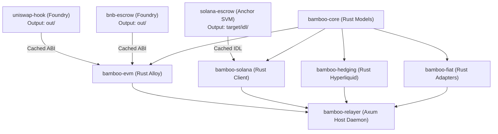

<!-- OPENWIKI:START -->
# Monorepo Build DAG & Moon Orchestration

Project Bamboo adopts a polyglot monorepo structure managed by **Moon (`moonrepo`)** to orchestrate smart contracts (Foundry Solidity and Anchor Rust) alongside host Rust daemons.



---

## Toolchain Isolation & Quarantining

### 1. Quarantining Anchor (`cargo-build-sbf`)
Solana smart contracts compiled with Anchor target the BPF/SBF architecture (`sbf-solana-solana`), requiring a custom LLVM toolchain. Including Anchor contracts as host workspace members inside root `Cargo.toml` causes fatal target pointer-width and dependency conflicts.

**Solution**:
- Anchor's program lives in its own isolated workspace ([`contracts/solana-escrow/Cargo.toml`](../../contracts/solana-escrow/Cargo.toml)).
- Moon manages it as a system platform task (`anchor build`).
- Root `Cargo.toml` contains only host x86_64 crates.

### 2. Artifact Caching for Downstream Crates
Downstream Rust clients depend on compiled contract ABIs and IDLs:
* `contracts/uniswap-hook/moon.yml` caches `out/`
* `contracts/bnb-escrow/moon.yml` caches `out/`
* `contracts/solana-escrow/moon.yml` caches `target/idl/`

Moon links task dependencies topologically so that running `moon run bamboo-evm:build` automatically triggers `uniswap-hook:build` and `bnb-escrow:build` first if their Solidity files have changed.

---

## Moon CLI Commands

```bash
# Run all project checks across the topological DAG
moon check

# Build the unified EVM client (triggers Foundry builds)
moon run bamboo-evm:build

# Run all unit and integration tests across all spokes and crates
moon run :test

# Run the unified host daemon
cargo run -p bamboo-relayer
```
<!-- OPENWIKI:END -->
