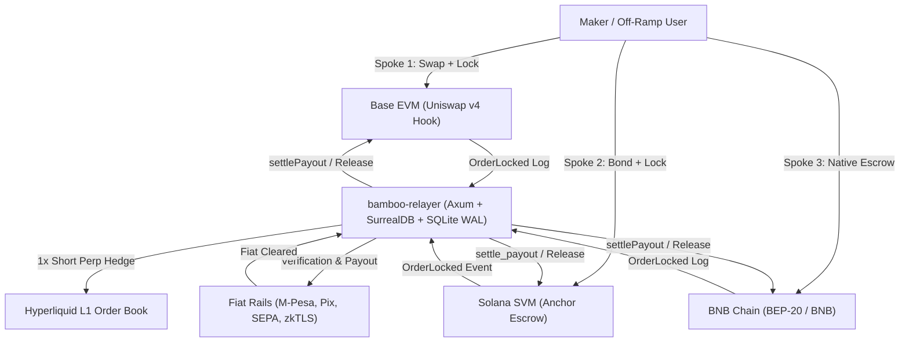

<!-- OPENWIKI:START -->
# Project Bamboo – Knowledge Wiki

> [!NOTE]
> **Status: v1 differs — see [docs/plan/](./plan/00-overview.md)**  
> Project Bamboo v1 implements a focused thin vertical slice (Solana USDC to M-Pesa KES via a single reference relayer). Architectural elements such as zkTLS proofs, multi-relayer markets, SurrealDB, and delta-neutral hedging represent long-term roadmap targets and are not active in v1. See [00-overview.md](./plan/00-overview.md).

Welcome to the **Project Bamboo** engineering knowledge base, formatted conforming to the **Open Knowledge Format (OKF v0.2)** for human readability and deterministic AI agent navigation.

Project Bamboo is a non-custodial, cross-chain fiat settlement engine operating across **Base (Uniswap v4)**, **Solana (Anchor SVM)**, and **BNB Chain (Native BEP-20 Escrow)**, coordinated by a zero-cloud Rust relayer daemon and a **Hyperliquid delta-neutral clearing spine**.

---

## Knowledge Graph & Directory Manifest

### 1. Vision & Core Philosophy
* [Vision & Manifesto](./vision.md) – The broken fiat last-mile problem, the open routing thesis, and non-custodial economic design.
* [Protocol Glossary](./glossary.md) – Authoritative dictionary of protocol terms, architectural primitives, and financial mechanics.

### 2. Architecture & Clearing Spine
* [System Overview & Architecture](./architecture/system-overview.md) – End-to-end architecture, three-spoke settlement rails, protocol fee cap (`MAX_HOST_FEE_BPS = 25`), and security invariants.
* [Why Choose Hyperliquid as a Clearing House](./architecture/why-hyperliquid.md) – Deep comparative evaluation of Hyperliquid L1 against CEXs, EVM perp AMMs, and Solana perp DEXs.
* [Delta-Neutral Hedging Spine](./architecture/delta-neutral-hedging.md) – Hyperliquid L1 1x automated short perps/spot hedging engine to neutralize collateral volatility during the fiat verification window.

### 3. Architecture Decision Records (ADRs)
* [ADR 0001 — Three-Spoke Cross-Chain Architecture Without Bridges](./decisions/0001-three-spoke-architecture.md) – Native deployment on Base, Solana, and BSC over wrapped token bridges.
* [ADR 0002 — Hyperliquid L1 as the Delta-Neutral Clearing Spine](./decisions/0002-hyperliquid-clearing-spine.md) – Selecting Hyperliquid L1 central limit order books for automated 1x short perp hedging.
* [ADR 0003 — Solana Spoke: Squads Protocol v4 Standard & Anti-Griefing Micro-Bonds](./decisions/0003-solana-squads-v4-architecture-and-micro-bonds.md) – Modular Anchor layout, isolated order PDAs, and 0.01 SOL micro-bonds.
* [ADR 0004 — Zero-Cloud Relayer Daemon: Embedded SurrealKV, ACID Ledger, and Native Changefeeds](./decisions/0004-relayer-zero-cloud-surrealkv.md) – Self-hosted single-binary Rust daemon backed by pure-Rust SurrealKV.
* [ADR 0005 — Domestic Fiat Adapters and zkTLS Attestation](./decisions/0005-domestic-fiat-adapters-and-zktls.md) – Native M-Pesa, Pix, and SEPA rails with zero-knowledge web session proofs.

### 4. Smart Contract Spokes
* [Spoke 1: Base EVM Hook](./spokes/base-uniswap-v4.md) – Uniswap v4 `BambooSettlementHook.sol`, transient storage (`TSTORE`/`TLOAD`), flash accounting, and peripheral multi-hop routing.
* [Spoke 2: Solana SVM Escrow](./spokes/solana-svm.md) – Anchor `bamboo_escrow` program, PDA isolation (`seeds = [b"order", order_id]`), 0.01 SOL anti-griefing micro-bonds, and Jupiter CPI integration.
* [Spoke 3: BNB Chain Native EVM](./spokes/bnb-chain.md) – BSC `BambooBscSettlement.sol`, native BNB and BEP-20 retail off-ramping, DEX router mappings, and 32-byte canonical hashes.

### 5. Off-Chain Relayer & Client Crates
* [Unified Host Daemon & Storage](./relayer/unified-host-daemon.md) – Axum single binary, SurrealDB 7-second RFQ countdown engine, and embedded SQLite (WAL mode) ACID double-entry accounting.
* [Domestic Fiat Adapters & zkTLS](./fiat/fiat-adapters-and-zktls.md) – Safaricom M-Pesa (East Africa), Pix (Latin America), SEPA Instant (Europe), and zkTLS web session proofs.

### 6. Engineering & Operations
* [Monorepo & Moon Orchestration](./guides/monorepo-orchestration.md) – `moonrepo` topological build DAG, contract artifact caching (`out/`, `target/idl/`), and isolated toolchains.
* [Changelog & Operational Log](./logs.md) – Chronological, date-grouped record of repository modifications and rollout milestones.

### 7. Bamboo v1 ("Thin") Implementation Plan
* [00: Architectural Overview](./plan/00-overview.md) – Baseline assessment, component map, trust model, and scope.
* [10: Solana Escrow Spec](./plan/10-solana-escrow.md) – Squattable-free Anchor escrow, 5-state machine, and race analysis.
* [11: Core & Solana Client](./plan/11-bamboo-core-and-solana-client.md) – Canonical order ID derivation and PDA decoding.
* [12: M-Pesa Adapter Spec](./plan/12-mpesa-adapter.md) – Safaricom Daraja B2C flow, authentication, and fail-closed handling.
* [13: Reference Relayer Daemon](./plan/13-relayer-daemon.md) – Event ingestion, finalized commitment, and pipeline.
* [14: Double-Entry Ledger](./plan/14-ledger.md) – File-backed SQLite WAL schema, chart of accounts, and reconciliation.
* [15: Liquidity & Treasury](./plan/15-liquidity-and-treasury.md) – Float mechanics, M-Pesa tariffs, and 25 bps unit economics.
* [20: Settlement Flows](./plan/20-integration-and-settlement-flows.md) – Sequence diagrams for happy path, disputes, and crash recovery.
* [30: Third-Party Integrator Guide](./plan/30-integration-guide.md) – Integration walkthrough, SDK snippets, and privacy architecture.
* [40: Phased Implementation Plan](./plan/40-implementation-plan.md) – Engineering roadmap, testing strategy, and risk register.
* [50: Open Decisions](./plan/50-open-decisions.md) – Decision matrix and critique of dispute and economic flaws.

<!-- OPENWIKI:END -->
