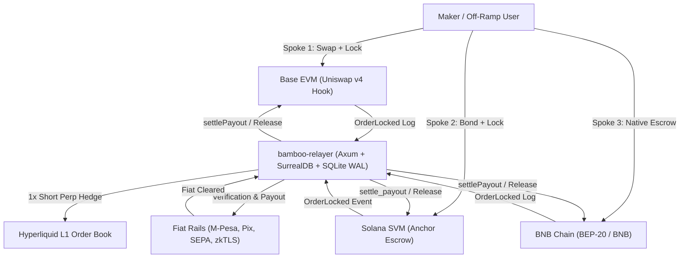

<!-- OPENWIKI:START -->
# Project Bamboo – Knowledge Wiki

Welcome to the **Project Bamboo** engineering knowledge base, formatted conforming to the **Open Knowledge Format (OKF v0.2)** for human readability and deterministic AI agent navigation.

Project Bamboo is a non-custodial, cross-chain fiat settlement engine operating across **Base (Uniswap v4)**, **Solana (Anchor SVM)**, and **BNB Chain (Native BEP-20 Escrow)**, coordinated by a zero-cloud Rust relayer daemon and a Hyperliquid delta-neutral clearing spine.

---

## Knowledge Graph & Directory Manifest

### 1. Architecture & Protocol Invariants
* [System Overview & Architecture](./architecture/system-overview.md) – End-to-end architecture, three-spoke settlement rails, protocol fee cap (`MAX_HOST_FEE_BPS = 25`), and security invariants.
* [Delta-Neutral Hedging Spine](./architecture/delta-neutral-hedging.md) – Hyperliquid L1 1x automated short perps/spot hedging engine to neutralize collateral volatility during the fiat verification window.

### 2. Smart Contract Spokes
* [Spoke 1: Base EVM Hook](./spokes/base-uniswap-v4.md) – Uniswap v4 `BambooSettlementHook.sol`, transient storage (`TSTORE`/`TLOAD`), flash accounting, and peripheral multi-hop routing.
* [Spoke 2: Solana SVM Escrow](./spokes/solana-svm.md) – Anchor `bamboo_escrow` program, PDA isolation (`seeds = [b"order", order_id]`), 0.01 SOL anti-griefing micro-bonds, and Jupiter CPI integration.
* [Spoke 3: BNB Chain Native EVM](./spokes/bnb-chain.md) – BSC `BambooBscSettlement.sol`, native BNB and BEP-20 retail off-ramping, DEX router mappings, and 32-byte canonical hashes.

### 3. Off-Chain Relayer & Client Crates
* [Unified Host Daemon & Storage](./relayer/unified-host-daemon.md) – Axum single binary, SurrealDB 7-second RFQ countdown engine, and embedded SQLite (WAL mode) ACID double-entry accounting.
* [Domestic Fiat Adapters & zkTLS](./fiat/fiat-adapters-and-zktls.md) – Safaricom M-Pesa (East Africa), Pix (Latin America), SEPA Instant (Europe), and zkTLS web session proofs.

### 4. Engineering & Operations
* [Monorepo & Moon Orchestration](./guides/monorepo-orchestration.md) – `moonrepo` topological build DAG, contract artifact caching (`out/`, `target/idl/`), and isolated toolchains.
* [Changelog & Operational Log](./logs.md) – Chronological, date-grouped record of repository modifications and rollout milestones.

<!-- OPENWIKI:END -->
