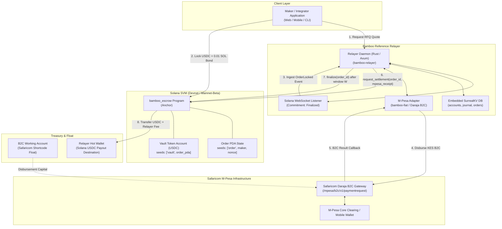
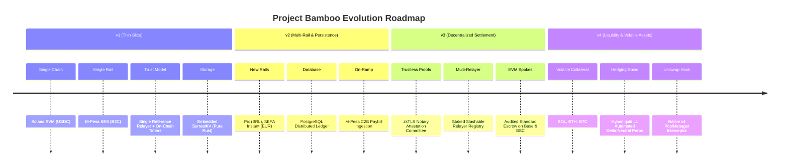

<!-- OPENWIKI:START -->
# Project Bamboo v1 ("Thin") — Architectural Overview

## 1. Baseline Assessment: Codebase Reality vs. Claims

Before planning the v1 implementation, every claim from prior reviews was verified directly against the active repository source code:

| Component | Documented Claim | Verified Code State | Citation |
|---|---|---|---|
| **Solana PDA Crate** (`bamboo-solana`) | Prior review flagged non-standard PDA derivation. | **Fixed.** The crate now implements standard Solana PDA derivation (`CompressedEdwardsY::decompress().is_none()`), searching bumps $255 \to 0$, with fail-closed checks on fee ceiling ($\le 25$ bps), bond floor ($\ge 0.01$ SOL), and status bytes. All 7 unit tests pass. | [`crates/bamboo-solana/src/lib.rs:57-77`](../../crates/bamboo-solana/src/lib.rs) |
| **Solana On-Chain Program** (`bamboo-escrow`) | Described as an enterprise Squads v4 escrow with anti-griefing protection. | **Flawed.** `order_id` is passed directly by the caller without binding to parameters; PDA seeds are solely `[b"order", order_id]`, allowing front-running/squatting. `duration_seconds` has no minimum or bounds. `settle_payout` has no proof requirement or expiry guard (races with refund). `claim_refund` requires the maker's signature (`maker: Signer`), violating its "permissionless refund" specification. Escrow and vault accounts are never closed, leaking rent lamports. "Squads v4" is purely cosmetic comments. | [`lock_order.rs:13-22`](../../contracts/solana-escrow/programs/bamboo-escrow/src/instructions/lock_order.rs) [`settle_payout.rs:43-52`](../../contracts/solana-escrow/programs/bamboo-escrow/src/instructions/settle_payout.rs) [`claim_refund.rs:21-23`](../../contracts/solana-escrow/programs/bamboo-escrow/src/instructions/claim_refund.rs) |
| **Fiat Adapters & zkTLS** (`bamboo-fiat`) | Documented as non-custodial zkTLS attestation and sovereign rails. | **Fails Open.** M-Pesa, Pix, and SEPA adapters return dummy success with `amount_fiat: 0.0`. The `ZkTlsVerifier` checks if the raw proof bytes contain the substring `"PAID"` and never validates against the `notarization_authority_key`. | [`crates/bamboo-fiat/src/lib.rs:95`](../../crates/bamboo-fiat/src/lib.rs) [`crates/bamboo-fiat/src/lib.rs:201-222`](../../crates/bamboo-fiat/src/lib.rs) |
| **Relayer Daemon** (`bamboo-relayer`) | Documented as an autonomous zero-cloud node with ACID SQLite double-entry. | **In-Memory & Unauthenticated.** `main.rs` initializes an ephemeral in-memory database (`new_in_memory()`), losing state on restart. `POST /orders/settle` is unauthenticated and accepts arbitrary payout values without on-chain or status verification. Double-entry `record_settlement_double_entry` inserts un-linked journal records without updating account balances. No on-chain WebSocket listeners or backfill loops exist. | [`crates/bamboo-relayer/src/main.rs:142`](../../crates/bamboo-relayer/src/main.rs) [`crates/bamboo-relayer/src/main.rs:59-81`](../../crates/bamboo-relayer/src/main.rs) [`crates/bamboo-relayer/src/db.rs:123-139`](../../crates/bamboo-relayer/src/db.rs) |
| **Hedging Engine** (`bamboo-hedging`) | Documented as automated 1x delta-neutral hedging on Hyperliquid L1. | **Stub.** `open_collateral_hedge` merely instantiates an in-memory struct and emits a log message. No network or order execution logic exists. | [`crates/bamboo-hedging/src/lib.rs:61-87`](../../crates/bamboo-hedging/src/lib.rs) |
| **EVM Spokes** (`contracts/bnb-escrow`, `contracts/uniswap-hook`) | Documented as Uniswap v4 hook and native BSC escrow. | **Vulnerable & Pseudo-Hook.** BSC escrow exhibits order ID squatting, duration=0 race condition, and fee-on-transfer insolvency. The Base "hook" declares custom interfaces with invalid method selectors that are incompatible with Uniswap v4 `IPoolManager`. | [`BambooBscSettlement.sol:48-59`](../../contracts/bnb-escrow/src/BambooBscSettlement.sol) [`BambooSettlementHook.sol:18-24`](../../contracts/uniswap-hook/src/BambooSettlementHook.sol) |

---

## 2. What Bamboo v1 Is and Is Not

### What Bamboo v1 Is
Bamboo v1 is an **off-ramp settlement protocol** configured as a **narrow, verifiable vertical slice**:
1. **One Blockchain:** Solana SVM only.
2. **One Asset:** USDC (SPL token).
3. **One Fiat Rail:** M-Pesa B2C (Kenyan Shilling, KES) via Safaricom Daraja API.
4. **One Reference Relayer:** Operated directly by the protocol team, funded with a dedicated KES float and USDC treasury.
5. **Contract-Enforced Timers:** A state machine on Solana ensuring that if the relayer fails to disburse fiat, the maker can reclaim 100% of their locked collateral and bond. If the maker disputes fiat receipt within an enforcement window $W$, the funds are frozen pending timeout resolution rather than instantly seized by the relayer.

### What Bamboo v1 Is NOT
- **It is NOT trustless or non-custodial on the fiat side:** Because the blockchain cannot independently verify Safaricom’s internal bank ledger, the protocol relies on the reference relayer to disburse local fiat honestly.
- **It is NOT zkTLS-verified:** No zero-knowledge TLS proofs or notary signatures are checked on-chain in v1.
- **It is NOT an open relayer marketplace:** There are no third-party relayers, no staking auctions, and no permissionless settlement competition in v1.
- **It does NOT include EVM or Cross-Chain Bridges:** BNB Chain and Base contracts are completely excluded from v1.
- **It does NOT execute delta-neutral hedging:** All collateral is assumed to be stablecoins (USDC), eliminating collateral volatility during settlement. Hyperliquid integration is deferred.
- **It is NOT an on-ramp:** Fiat-to-crypto flows are out of scope.

---

## 3. High-Level Component Map

The v1 system connects an end-user application to the Safaricom M-Pesa rail through Solana and an off-chain reference relayer:

---

## 4. Trust Model Table

| Actor | What They Are Trusted To Do | What They CANNOT Do | What Happens If They Misbehave |
|---|---|---|---|
| **Maker (User)** | Provide accurate phone number and pay network gas/bond. Call `dispute` only if fiat was not received. | Cannot steal relayer funds; cannot withdraw locked tokens before expiration unless disputed; cannot squat another user's order ID. | If the maker falsely disputes a valid payout, funds enter the `Disputed` state. In v1, funds are locked until a dispute timeout expires. |
| **Integrator App** | Accurately compute recipient hashes and display correct status, timers, and dispute buttons to the maker. | Cannot sign transactions on behalf of the maker without their private key; cannot modify escrow parameters signed by the maker. | If an integrator produces an incorrect recipient hash, the relayer's verification fails closed, refusing the order. |
| **Reference Relayer** | Disburse exact KES amounts to the recipient phone number within the timelock window. Submit genuine M-Pesa transaction receipts on-chain. | Cannot withdraw escrowed tokens without invoking `request_settlement` and waiting for the dispute window $W$ to elapse; cannot bypass on-chain duration checks. | If the relayer fails to pay fiat, the maker claims a 100% refund of their USDC deposit and 0.01 SOL bond at order expiry. If the relayer claims settlement fraudulently, the maker triggers `dispute`. |
| **Solana Program** | Deterministically enforce states, timeouts ($W$, expiry), account ownership, token transfers, and rent return. | Cannot alter parameters after order creation; cannot release funds to the relayer prior to window $W$ completion. | Program logic is immutable and verified on-chain. Bugs or logic failures are mitigated by unit/fuzz tests, fail-closed assertions, and formal audit. |
| **Safaricom (M-Pesa)** | Process B2C disbursements and accurately report transaction status callbacks to the relayer. | Cannot interact with Solana smart contracts or modify crypto balances. | If Daraja drops callbacks or experiences downtime, the relayer polls `/mpesa/transactionstatus/v1/query` before attempting settlement. |

---

## 5. Out of Scope for v1 ("Whole Bamboo" Roadmap)

The following items are deferred to future milestones:

1. **Third-Party Relayer Marketplace & On-Chain Slashing (v3):** v1 operates with a single known reference relayer. Decentralized relayer staking, bonding curves, and slashing arbitration mechanisms will be introduced when transitioning to a permissionless network.
2. **zkTLS & Notary Verification (v3):** Attestation of bank/TLS sessions directly by smart contracts requires standardized TLSNotary verification contracts, deferred until v3.
3. **EVM Escrows & Uniswap v4 Hook (v3/v4):** Deploying an audited, shared escrow contract across Base and BSC, followed by a valid v4 `IPoolManager` hook once Uniswap v4 mainnet liquidity stabilizes.
4. **Hyperliquid Delta-Neutral Hedging (v4):** Required only when accepting volatile tokens (SOL, BNB, ETH). Because v1 exclusively accepts stablecoins (USDC), price volatility is non-existent.

<!-- OPENWIKI:END -->
