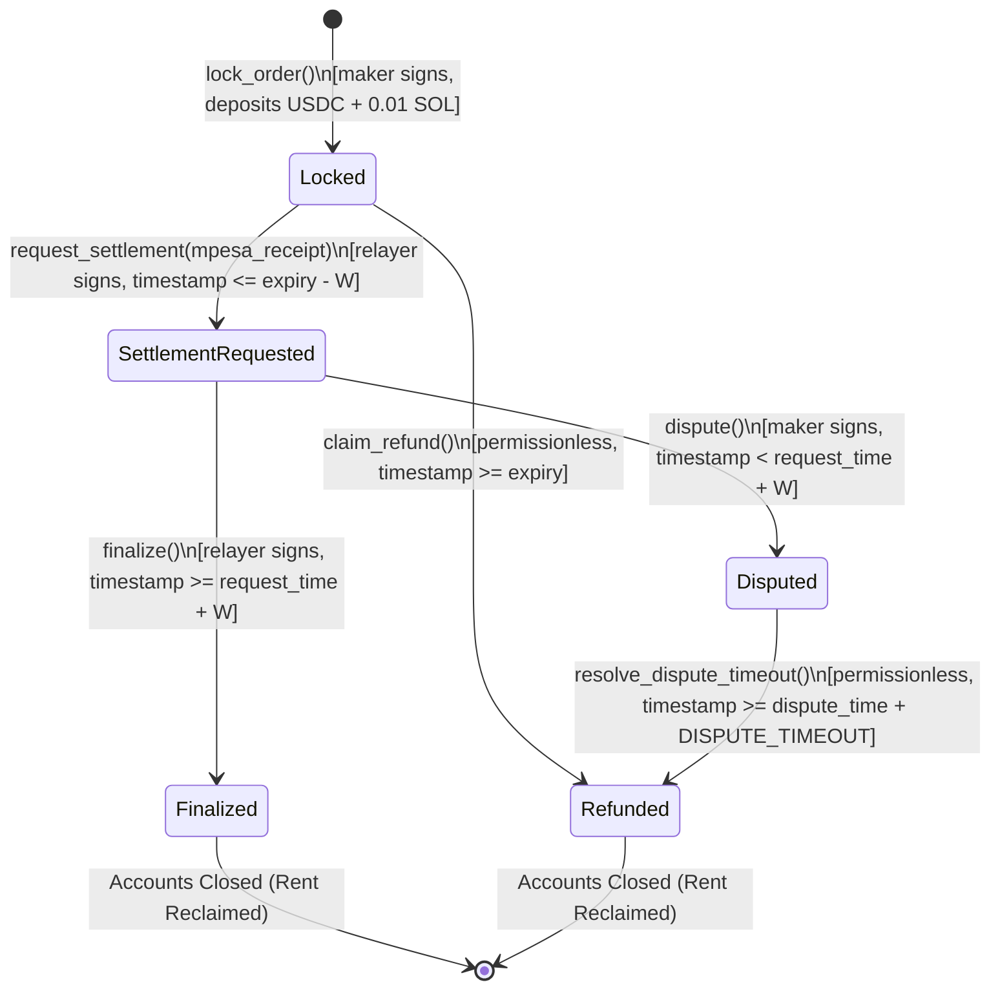

<!-- OPENWIKI:START -->
# Component Specification: Solana Escrow Program (`bamboo-escrow`)

## 1. Purpose & Responsibilities

The `bamboo_escrow` Solana Anchor program is the sovereign settlement layer of Project Bamboo v1. It provides deterministic, non-custodial cryptographic custody of crypto collateral during off-ramp fiat execution.

### Responsibilities
- **Collateral Custody:** Atomically lock SPL tokens (USDC) from the maker's token account into a dedicated program-derived token vault.
- **Anti-Griefing Micro-Bond:** Collect a refundable $0.01\text{ SOL}$ ($10{,}000{,}000\text{ lamports}$) bond from the maker upon order creation to prevent order book DoS spam.
- **Deterministic Order ID Derivation:** Compute canonical order IDs on-chain from transaction parameters and enforce un-squattable, maker-isolated PDA address spaces.
- **State & Timelock Enforcement:** Strictly enforce order lifecycle state transitions, including lock durations, settlement challenge windows ($W$), dispute freezes, and permissionless expiration refunds.
- **Atomic Payout Distribution:** Split collateral into maker payout and relayer host fee ($\le 25\text{ bps}$) upon finalization.
- **Rent Reclamation:** Close order and vault accounts upon terminal states (`Finalized`, `Refunded`), refunding rent-exempt lamports back to the payer.

### Non-Responsibilities
- Does NOT execute or verify off-chain fiat transactions directly.
- Does NOT interface with banking APIs or Safaricom Daraja.
- Does NOT perform currency exchange rate calculations or RFQ pricing.
- Does NOT support cross-chain messaging or bridging.

---

## 2. On-Chain State Machine & Transitions

The escrow lifecycle follows a deterministic, unidirectional finite state machine designed to eliminate settlement/refund race conditions:



### Complete Transition Matrix

| Current State | Target State | Triggering Instruction | Authorized Caller | Preconditions | On-Chain Effects |
|---|---|---|---|---|---|
| `None` | `Locked` | `lock_order` | Maker | $D_{\min} \le \text{duration} \le D_{\max}$, fee $\le 25$ bps, token = allowed mint | Vault created; USDC transferred; 0.01 SOL bond deposited; `order_id` computed |
| `Locked` | `SettlementRequested` | `request_settlement` | Assigned Relayer | `clock.unix_timestamp <= order.expiry - W` | Status $\to$ `SettlementRequested`; `settlement_requested_at` and `mpesa_receipt` recorded |
| `Locked` | `Refunded` | `claim_refund` | Permissionless (Anyone) | `clock.unix_timestamp >= order.expiry` | 100% USDC returned to maker; 0.01 SOL bond returned to maker; accounts closed |
| `SettlementRequested` | `Disputed` | `dispute` | Maker | `clock.unix_timestamp < order.settlement_requested_at + W` | Status $\to$ `Disputed`; `disputed_at` recorded |
| `SettlementRequested` | `Finalized` | `finalize` | Assigned Relayer | `clock.unix_timestamp >= order.settlement_requested_at + W` | USDC split: $(100\% - \text{fee}) \to$ recipient/relayer, $\text{fee} \to$ relayer; bond $\to$ maker; accounts closed |
| `Disputed` | `Refunded` | `resolve_dispute_timeout` | Permissionless (Anyone) | `clock.unix_timestamp >= order.disputed_at + DISPUTE_TIMEOUT` | 100% USDC returned to maker; 0.01 SOL bond returned to maker; accounts closed |
| **All Other** | Any | *Any* | *Any* | *Any* | **REVERT:** `InvalidStateTransition` |

---

## 3. Account Schemas & PDA Derivations

### 3.1 Order PDA Seed Derivation (Squat-Proof)
In prior versions ([`lock_order.rs:19`](../../contracts/solana-escrow/programs/bamboo-escrow/src/instructions/lock_order.rs)), seeds were simply `[b"order", order_id]`, allowing front-runners to observe an order ID in the mempool and initialize the PDA with 1 dust token.

In v1, order PDAs are strictly partitioned by the maker's public key and a per-maker sequential `nonce`:
$$\text{Order PDA Seeds} = [\text{b"order"},\; \text{maker\_pubkey},\; \text{nonce.to\_le\_bytes}()]$$

Because the maker is a required signer for initialization, no external party can squat or pre-occupy another user's order PDA.

### 3.2 Token Vault PDA Seed Derivation
$$\text{Vault PDA Seeds} = [\text{b"vault"},\; \text{order\_pda\_pubkey}]$$
The vault is an Associated Token Account or direct PDA token account owned by the Order PDA.

### 3.3 On-Chain Data Structures

```rust
use anchor_lang::prelude::*;

#[repr(u8)]
#[derive(AnchorSerialize, AnchorDeserialize, Clone, Copy, PartialEq, Eq, Debug)]
pub enum EscrowStatus {
    None = 0,
    Locked = 1,
    SettlementRequested = 2,
    Disputed = 3,
    Finalized = 4,
    Refunded = 5,
}

#[account]
#[derive(Debug)]
pub struct OrderAccount {
    /// Canonical 32-byte order ID derived on-chain
    pub order_id: [u8; 32],
    /// Maker public key (source of funds and recipient of refunds/bonds)
    pub maker: Pubkey,
    /// Authorized relayer public key
    pub assigned_relayer: Pubkey,
    /// Token mint (must equal authorized USDC mint)
    pub token_mint: Pubkey,
    /// Associated token vault PDA
    pub token_vault: Pubkey,
    /// Total collateral amount locked (in token atomic units, 6 decimals)
    pub amount: u64,
    /// SHA256 salted hash of domestic fiat recipient phone number
    pub fiat_recipient_hash: [u8; 32],
    /// Refundable anti-griefing micro-bond (10_000_000 lamports = 0.01 SOL)
    pub anti_griefing_bond: u64,
    /// Absolute Unix timestamp when order expires
    pub expiry_timestamp: i64,
    /// Absolute Unix timestamp when relayer requested settlement (0 if not requested)
    pub settlement_requested_at: i64,
    /// Absolute Unix timestamp when maker flagged dispute (0 if not disputed)
    pub disputed_at: i64,
    /// Safaricom M-Pesa transaction reference (max 32 ascii bytes, e.g. "QKH1234567")
    pub mpesa_receipt: [u8; 32],
    /// Host relayer fee in basis points (max 25 bps = 0.25%)
    pub host_fee_bps: u16,
    /// User nonce for order derivation
    pub nonce: u64,
    /// Current state of the order
    pub status: EscrowStatus,
    /// PDA bump
    pub bump: u8,
    /// Token vault bump
    pub vault_bump: u8,
}

impl OrderAccount {
    pub const LEN: usize = 32   // order_id
        + 32                    // maker
        + 32                    // assigned_relayer
        + 32                    // token_mint
        + 32                    // token_vault
        + 8                     // amount
        + 32                    // fiat_recipient_hash
        + 8                     // anti_griefing_bond
        + 8                     // expiry_timestamp
        + 8                     // settlement_requested_at
        + 8                     // disputed_at
        + 32                    // mpesa_receipt
        + 2                     // host_fee_bps
        + 8                     // nonce
        + 1                     // status
        + 1                     // bump
        + 1;                    // vault_bump
}
```

---

## 4. Time Parameters & Invariants

| Parameter | Identifier | Value | Justification |
|---|---|---|---|
| Minimum Lock Duration | `MIN_DURATION_SECONDS` | `900` (15 minutes) | Prevents zero-duration griefing; ensures sufficient time for fiat clearing. |
| Maximum Lock Duration | `MAX_DURATION_SECONDS` | `604,800` (7 days) | Bounds working capital lockup; prevents indefinite token custody. |
| Dispute Window | `SETTLEMENT_WINDOW_SECONDS` ($W$) | `1,800` (30 minutes) | Gives maker sufficient window to receive SMS notification and flag non-payment. |
| Maximum Settlement Threshold | $\text{expiry} - W$ | Variable | Relayer MUST call `request_settlement` before this timestamp. Prevents settlement/refund race. |
| Dispute Freeze Timeout | `DISPUTE_TIMEOUT_SECONDS` | `604,800` (7 days) | If disputed, funds freeze to allow off-chain investigation. Reverts to maker upon timeout. |
| Fee Ceiling | `MAX_HOST_FEE_BPS` | `25` ($0.25\%$) | Protocol-wide cap protecting makers from fee gouging. |
| Anti-Griefing Bond | `ANTI_GRIEFING_BOND_LAMPORTS` | `10,000,000` ($0.01\text{ SOL}$) | Economic deterrent against mass zero-capital order creation. |

---

## 5. Instruction Definitions & Constraints

### 5.1 `lock_order`
- **Signers:** `maker`
- **Accounts:**
  - `maker`: Mut, Signer
  - `order`: Init, Seeds = `[b"order", maker.key(), nonce.to_le_bytes()]`
  - `assigned_relayer`: AccountInfo (must match authorized reference relayer)
  - `token_mint`: AccountInfo (must match authorized USDC mint)
  - `maker_token_account`: Mut, SPL Token Account (mint matches `token_mint`, owner matches `maker`)
  - `token_vault`: Init, Seeds = `[b"vault", order.key()]`
  - `token_program`, `system_program`, `rent`
- **Arguments:**
  - `nonce: u64`
  - `amount: u64` (minimum $1{,}000{,}000 = 1\text{ USDC}$)
  - `fiat_recipient_hash: [u8; 32]`
  - `duration_seconds: i64`
  - `host_fee_bps: u16`
- **Preconditions:**
  - `duration_seconds >= MIN_DURATION_SECONDS && duration_seconds <= MAX_DURATION_SECONDS`
  - `host_fee_bps <= MAX_HOST_FEE_BPS`
  - `token_mint.key() == ALLOWED_USDC_MINT`
- **Canonical Order ID Computation:**
  ```rust
  let mut hasher = Sha256::new();
  hasher.update(b"BAMBOO_ORDER_V1");
  hasher.update(maker.key().as_ref());
  hasher.update(token_mint.key().as_ref());
  hasher.update(&amount.to_le_bytes());
  hasher.update(&fiat_recipient_hash);
  hasher.update(assigned_relayer.key().as_ref());
  hasher.update(&nonce.to_le_bytes());
  let order_id: [u8; 32] = hasher.finalize().into();
  ```

### 5.2 `request_settlement`
- **Signers:** `relayer`
- **Accounts:**
  - `order`: Mut, Seeds = `[b"order", order.maker, order.nonce.to_le_bytes()]`
  - `relayer`: Signer, `constraint = relayer.key() == order.assigned_relayer`
- **Arguments:**
  - `mpesa_receipt: [u8; 32]`
- **Preconditions:**
  - `order.status == EscrowStatus::Locked`
  - `clock.unix_timestamp <= order.expiry_timestamp - SETTLEMENT_WINDOW_SECONDS`
- **Effects:**
  - `order.status = EscrowStatus::SettlementRequested`
  - `order.settlement_requested_at = clock.unix_timestamp`
  - `order.mpesa_receipt = mpesa_receipt`
  - Emits `SettlementRequestedEvent`

### 5.3 `dispute`
- **Signers:** `maker`
- **Accounts:**
  - `order`: Mut, Seeds = `[b"order", order.maker, order.nonce.to_le_bytes()]`
  - `maker`: Signer, `constraint = maker.key() == order.maker`
- **Preconditions:**
  - `order.status == EscrowStatus::SettlementRequested`
  - `clock.unix_timestamp < order.settlement_requested_at + SETTLEMENT_WINDOW_SECONDS`
- **Effects:**
  - `order.status = EscrowStatus::Disputed`
  - `order.disputed_at = clock.unix_timestamp`
  - Emits `OrderDisputedEvent`

### 5.4 `finalize`
- **Signers:** `relayer`
- **Accounts:**
  - `order`: Mut, Close = `maker` (rent lamports refunded to maker)
  - `relayer`: Signer, `constraint = relayer.key() == order.assigned_relayer`
  - `maker`: Mut, AccountInfo (receives 0.01 SOL bond)
  - `token_vault`: Mut, Token Account
  - `relayer_token_account`: Mut, Token Account
  - `token_program`
- **Preconditions:**
  - `order.status == EscrowStatus::SettlementRequested`
  - `clock.unix_timestamp >= order.settlement_requested_at + SETTLEMENT_WINDOW_SECONDS`
- **Effects:**
  - Transfers 100% of tokens in vault to `relayer_token_account` via CPI signed by Order PDA
  - Closes `token_vault` token account via `token::close_account` CPI, refunding vault rent to `maker`
  - Returns `anti_griefing_bond` ($0.01\text{ SOL}$) to `maker`
  - Closes `order` PDA account, returning account rent to `maker`
  - Emits `OrderFinalizedEvent`

### 5.5 `claim_refund`
- **Signers:** *Permissionless (Signer pays transaction fee)*
- **Accounts:**
  - `order`: Mut
  - `maker`: Mut, AccountInfo (`constraint = maker.key() == order.maker`)
  - `token_vault`: Mut, Token Account
  - `maker_token_account`: Mut, Token Account (`constraint = maker_token_account.owner == order.maker`)
  - `token_program`
- **Preconditions:**
  - `order.status == EscrowStatus::Locked`
  - `clock.unix_timestamp >= order.expiry_timestamp`
- **Effects:**
  - Transfers $100\%$ of `order.amount` from `token_vault` to `maker_token_account` via CPI
  - Closes `token_vault` token account, sending rent to `maker`
  - Refunds `anti_griefing_bond` ($0.01\text{ SOL}$) to `maker`
  - Closes `order` PDA account, sending rent to `maker`
  - Emits `OrderRefundedEvent`

---

## 6. Race Condition Analysis

```
Timeline: [0 ---------------- expiry - W -------------- expiry]
                                     |                     |
Case 1: Relayer requests here: <----+                      |
        -> Dispute window W runs.                          |
        -> Maker can dispute during W.                     |
        -> Relayer can finalize after W.                   |
        -> Expiry cannot trigger refund because            |
           status != Locked.                               |
                                                           |
Case 2: Relayer tries to request here: --------> [X REVERTS]|
        -> Transaction rejected by contract.               |
        -> At expiry, Maker or Relayer claims refund. <----+
```

1. **Settlement vs. Expiry Race:**
   - **Vulnerability in old code:** If an order expires at $T$, the relayer could call `settle_payout` at $T+1$ while the maker simultaneously called `claim_refund`.
   - **Resolution:** A settlement request is invalid unless submitted at $t \le \text{expiry} - W$. Once `request_settlement` succeeds, the status becomes `SettlementRequested`, blocking `claim_refund`. If $t > \text{expiry} - W$, `request_settlement` reverts, guaranteeing the maker's refund.
2. **Double-Spend / Reentrancy:**
   - Vault tokens are transferred only via Anchor CPI with PDA signing seeds. State is mutated or closed within the transaction. Account balance checks guarantee zero funds remain in the vault prior to account closure.
3. **Mempool Front-Running / Squatting:**
   - Addressed by maker-seeded PDAs (`[b"order", maker, nonce]`). No third party can initialize a PDA belonging to another maker.
4. **Rent Trap / Account Bloat:**
   - Both `finalize` and `claim_refund` explicitly invoke `token::close_account` and return order account rent lamports to the maker. Zero dead accounts remain on Solana.

---

## 7. Isolation Testing & Acceptance Criteria

### Unit & Bankrun Tests (`anchor test`)
1. `test_lock_order_success`: Verifies token deposit, bond debit, on-chain ID computation, and PDA seed isolation.
2. `test_lock_order_below_min_duration`: Asserts failure when `duration < 900s`.
3. `test_lock_order_exceed_fee_ceiling`: Asserts failure when `fee_bps > 25`.
4. `test_request_settlement_after_cutoff`: Asserts revert when `timestamp > expiry - W`.
5. `test_dispute_within_window`: Verifies transition to `Disputed`.
6. `test_dispute_after_window`: Asserts failure when `timestamp >= request + W`.
7. `test_finalize_before_window_fails`: Asserts failure when `timestamp < request + W`.
8. `test_permissionless_refund`: Verifies that an arbitrary signer can execute `claim_refund` past expiry and funds reach maker.
9. `test_accounts_closed_and_rent_reclaimed`: Asserts order PDA and vault PDA have 0 lamports and null data after finalization/refund.

<!-- OPENWIKI:END -->
