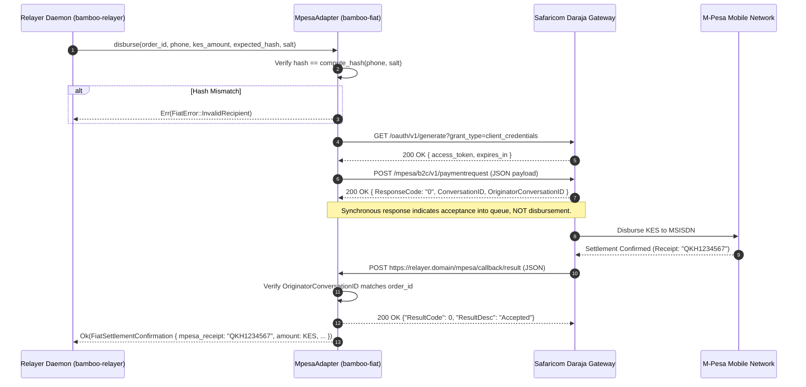

<!-- OPENWIKI:START -->
# Component Specification: M-Pesa Fiat Adapter (`bamboo-fiat`)

## 1. Purpose & Responsibilities

The `MpesaAdapter` in `bamboo-fiat` executes automated fiat disbursements into Kenyan mobile money accounts via Safaricom’s official Daraja B2C (Business-to-Consumer) API.

### Responsibilities
- **Recipient Verification:** Validate maker-submitted recipient phone numbers against on-chain `fiat_recipient_hash` before initiating banking rails.
- **Fail-Closed Execution:** Eliminate all dummy stubs (`amount_fiat: 0.0`). Revert and return typed errors on any authentication, parameter, or network failure.
- **B2C Disbursement:** Authenticate via OAuth 2.0, generate RSA-encrypted credentials, and dispatch payment requests to Safaricom Daraja.
- **Callback Ingestion & Verification:** Listen for asynchronous HTTP callbacks on `ResultURL` and `QueueTimeOutURL`, validate payload structure, and extract the definitive M-Pesa transaction reference (e.g., `QKH1234567`).
- **Status Reconciliation:** Poll Safaricom's Transaction Status API upon callback timeout or dropped connection to prevent duplicate payments.

### Non-Responsibilities
- Does NOT interact with Solana smart contracts directly (relayer daemon orchestrates on-chain calls).
- Does NOT manage domestic bank-to-M-Pesa cash float transfers.
- Does NOT store plaintext phone numbers on-chain.

---

## 2. Safaricom Daraja B2C Protocol Specification

Safaricom Daraja B2C is strictly **asynchronous**. Initiating a payment returns an acceptance acknowledgment; final confirmation arrives exclusively via an HTTP POST callback to the registered `ResultURL`.



---

## 3. Detailed API Mechanics & Payload Schemas

### 3.1 Authentication: OAuth 2.0 Bearer Token
- **Endpoint:** `GET https://api.safaricom.co.ke/oauth/v1/generate?grant_type=client_credentials`  
  *(Sandbox: `https://sandbox.safaricom.co.ke/oauth/v1/generate?grant_type=client_credentials`)*
- **Headers:** `Authorization: Basic base64(CONSUMER_KEY:CONSUMER_SECRET)`
- **Response:**
  ```json
  {
    "access_token": "cN0A...g39",
    "expires_in": "3599"
  }
  ```

### 3.2 Security Credential Generation
Safaricom requires the initiator operator password to be encrypted using Safaricom's X.509 public key certificate:
1. Load Safaricom's public certificate (`ProductionCertificate.cer` or `SandboxCertificate.cer`).
2. Encrypt the plaintext `InitiatorPassword` using **RSA with PKCS#1 v1.5 padding**.
3. Encode the ciphertext as Base64.

### 3.3 B2C Payment Request
- **Endpoint:** `POST https://api.safaricom.co.ke/mpesa/b2c/v1/paymentrequest`
- **Headers:** `Authorization: Bearer <access_token>`, `Content-Type: application/json`
- **Request Schema:**
  ```json
  {
    "InitiatorName": "bamboo_initiator",
    "SecurityCredential": "MIIBIjANBgkqhkiG9w0BAQEFAAOCAQ8AMIIBCgKCAQEA...",
    "CommandID": "BusinessPayment",
    "Amount": 13050,
    "PartyA": "600999",
    "PartyB": "254712345678",
    "Remarks": "Bamboo Order 18334812a76f",
    "QueueTimeOutURL": "https://relayer.protocol.org/api/v1/mpesa/timeout",
    "ResultURL": "https://relayer.protocol.org/api/v1/mpesa/result",
    "Occasion": "BambooOfframp"
  }
  ```

| Field | Constraints | Description |
|---|---|---|
| `CommandID` | `BusinessPayment` | Standard B2C commercial disbursement. |
| `Amount` | Integer, $\ge 10$, $\le 150{,}000$ | KES amount. M-Pesa does not support fractional cents in B2C. |
| `PartyA` | 6-digit shortcode | Relayer B2C working organization shortcode. |
| `PartyB` | MSISDN (`2547XXXXXXXX`, `2541XXXXXXXX`) | Validated Kenyan mobile subscriber number. |
| `QueueTimeOutURL` | Public HTTPS, valid SSL | Target if Safaricom's queue expires before reaching telco switch. |
| `ResultURL` | Public HTTPS, valid SSL | Target for definitive outcome callback. |

### 3.4 Asynchronous Result Callback (`ResultURL`)
When settlement finishes on M-Pesa, Safaricom dispatches an HTTP POST to `ResultURL`:

```json
{
  "Result": {
    "ResultType": 0,
    "ResultCode": 0,
    "ResultDesc": "The service request is processed successfully.",
    "OriginatorConversationID": "28374-1029384-1",
    "ConversationID": "AG_20260929_00004f176f543857",
    "TransactionID": "QKH1234567",
    "ResultParameters": {
      "ResultParameter": [
        { "Key": "TransactionAmount", "Value": 13050.0 },
        { "Key": "TransactionReceipt", "Value": "QKH1234567" },
        { "Key": "B2CRecipientIsRegisteredCustomer", "Value": "Y" },
        { "Key": "B2CWorkingAccountAvailableFunds", "Value": 482910.0 },
        { "Key": "TransactionCompletedDateTime", "Value": "29.09.2026 14:32:01" }
      ]
    },
    "ReferenceData": {
      "ReferenceItem": { "Key": "QueueTimeoutURL", "Value": "..." }
    }
  }
}
```

---

## 4. Fail-Closed Error & Reversal Handling

### 4.1 Strict Fail-Closed Invariants
1. **Hash Verification:** Prior to invoking Daraja, the adapter recomputes:
   $$\text{computed\_hash} = \text{SHA256}(\text{"BAMBOO\_FIAT\_V1"} \parallel \text{phone} \parallel \text{salt})$$
   If $\text{computed\_hash} \ne \text{order.fiat\_recipient\_hash}$, the call **immediately aborts** with `FiatError::InvalidRecipient`.
2. **Rejection of Dummy Successes:** All code paths returning `amount_fiat: 0.0` or checking substrings like `"PAID"` are removed. If `ResultCode != 0`, the transaction is marked as failed.
3. **Receipt Validation:** `TransactionReceipt` must match the regex `^[A-Z0-9]{10}$` (10-character alphanumeric Safaricom format).

### 4.2 Callback Loss & Polling Recovery
If neither `ResultURL` nor `QueueTimeOutURL` receives a webhook within **90 seconds** of initial submission:
1. The adapter executes an active status check:
   `POST https://api.safaricom.co.ke/mpesa/transactionstatus/v1/query`
   passing the `ConversationID` and `OriginatorConversationID`.
2. Only if the status query confirms `TransactionStatus: Completed` is the settlement marked confirmed.
3. If the query confirms `Failed` or `Not Found`, the adapter logs the failure and does NOT request settlement on-chain, allowing the maker's order to expire and refund safely.

### 4.3 Policy on Reversals
M-Pesa B2C payments are final credit transfers to a consumer's mobile wallet. Safaricom customer care **does not automatically reverse B2C payments** without the explicit written authorization of the initiating merchant organization. The relayer's automated systems never consent to reversals for settled orders.

---

## 5. Safaricom Commercial Onboarding & Lead Times

Operating the M-Pesa B2C rail in production requires legal and operational prerequisites:

| Requirement | Details | Lead Time |
|---|---|---|
| **Kenyan Corporate Entity** | Certificate of Incorporation, CR12 (company ownership registry), KRA Tax PIN. | 1–2 weeks |
| **Safaricom Business Shortcode** | Application for a dedicated B2C Organization Shortcode with KCB, NCBA, or Stanbic bank account integration. | 2–3 weeks |
| **Daraja Portal Operator KYC** | Creation of B2C Initiator username and security certificate generation in Safaricom portal. | 3–5 business days |
| **Public IP Whitelisting** | Safaricom requires fixed static public IP addresses for API callbacks. | 2 business days |
| **Total Onboarding Estimate** | **4 to 6 weeks** from corporate entity registration to live production transactions. |

---

## 6. Official Documentation Citations

- Safaricom Daraja Developer Portal: [https://developer.safaricom.co.ke/docs](https://developer.safaricom.co.ke/docs)
- Safaricom B2C API Reference: `POST /mpesa/b2c/v1/paymentrequest`
- Safaricom Transaction Status API: `POST /mpesa/transactionstatus/v1/query`
- Public Key Cryptography Standards: PKCS#1 v1.5 RSA encryption for M-Pesa Security Credentials.

<!-- OPENWIKI:END -->
