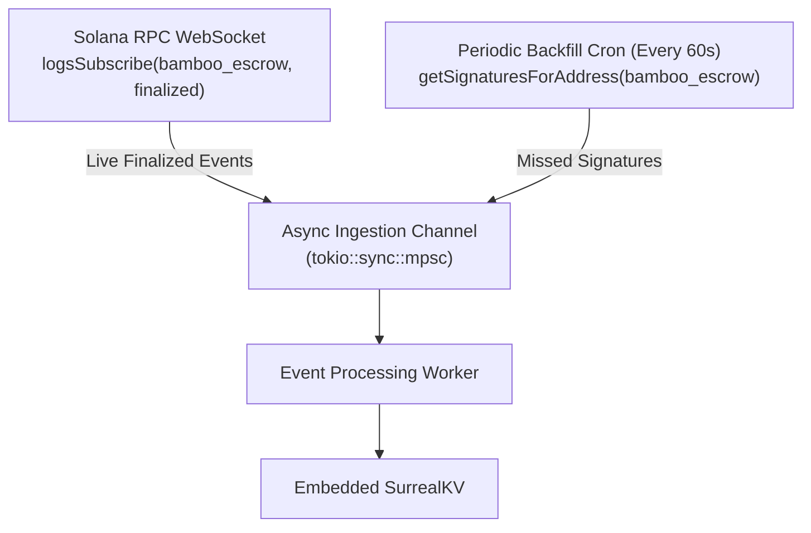
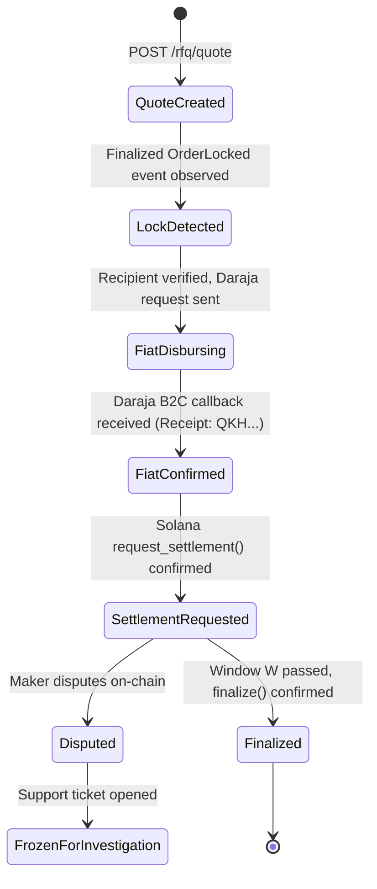
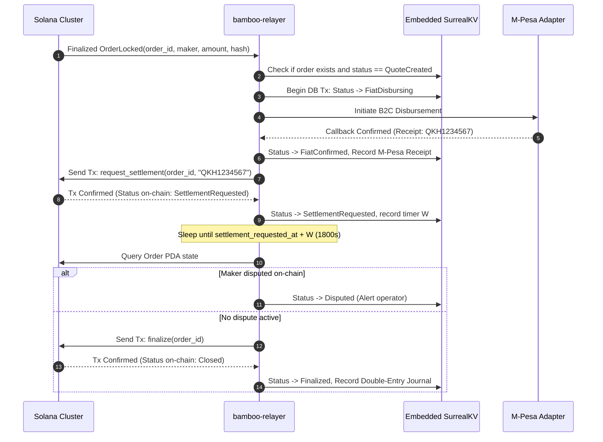

<!-- OPENWIKI:START -->
# Component Specification: Reference Relayer Daemon (`bamboo-relayer`)

## 1. Purpose & Responsibilities

The `bamboo-relayer` daemon is a single-binary Rust service that orchestrates the bridge between the Solana on-chain state machine and the Safaricom M-Pesa fiat network.

### Responsibilities
- **On-Chain Event Ingestion:** Monitor the Solana blockchain using WebSocket pub-sub with `finalized` commitment, supplemented by periodic backfill RPC polling.
- **RFQ Rate Quoting:** Serve signed, time-bounded exchange rate quotes ($\le 7\text{ seconds}$) via REST and WebSocket channels.
- **Automated Payout Pipeline:** Upon detecting a finalized `OrderLocked` event, validate order parameters, initiate M-Pesa B2C payment, and capture transaction references.
- **On-Chain Settlement Lifecycle:** Submit `request_settlement` on Solana, monitor the dispute window ($W$), and trigger `finalize` once $W$ expires.
- **Crash Recovery & Idempotency:** Persist operational state into an ACID Embedded SurrealKV ledger so that daemon restarts resume pending orders without duplicate fiat disbursements.

---

## 2. Solana Event Ingestion & Finality Policy

### 2.1 Commitment Level Justification: `Finalized`
The relayer enforces `CommitmentConfig::finalized()` (~31 block confirmations, approximately 12–15 seconds on Solana) before initiating any fiat transfer.

| Commitment Level | Latency | Fork Reorganization Risk | Suitability for Fiat Off-Ramping |
|---|---|---|---|
| `processed` | ~400ms | High (local node view) | **Unacceptable.** High probability of paying fiat on rolled-back transactions. |
| `confirmed` | ~1–2s | Extremely low (<0.01%), but possible during severe cluster partition | **Unsafe.** If a confirmed transaction is reorged out after fiat is sent, the relayer permanently loses the payout. |
| `finalized` | ~12–15s | Cryptographically zero (supermajority rooted) | **Mandatory.** Because Safaricom M-Pesa disbursements are irreversible, the relayer MUST require absolute finality. |

### 2.2 Event Stream Architecture & Backfill


1. **Live Stream:** Connects to Solana RPC WebSocket via `logsSubscribe` filtered by the `bamboo_escrow` program ID with `finalized` commitment.
2. **Backfill Loop:** Every 60 seconds, polls `getSignaturesForAddress` to catch any event dropped during transient network disconnects.
3. **Deduplication:** Uses on-chain transaction signatures and canonical `order_id` in SurrealKV unique indexes (`idx_order_id`) to ensure events are processed exactly once.

---

## 3. Order Lifecycle State Synchronization

The relayer tracks an extended internal state machine that mirrors and augments the Solana on-chain states:



---

## 4. RFQ Engine & Quotation Architecture

In prior versions ([`rfq.rs:54`](../../crates/bamboo-relayer/src/rfq.rs)), rates were hardcoded to `130.50` with an unsigned response.

### 4.1 Production RFQ Mechanics
1. **Rate Feed Ingestion:** The relayer polls live wholesale USD/KES rates from institutional FX feeds or local liquid order books, adding a configurable relayer spread ($\approx 1.0\%\text{ to }1.5\%$) to cover M-Pesa disbursement tariffs and treasury rebalancing.
2. **Deterministic Fee Enforcement:** Verifies that `host_fee_bps` never exceeds `MAX_HOST_FEE_BPS` (100 bps / 1.00%).
3. **Cryptographic Quote Signing:** Each quote is signed by the relayer's ed25519 identity key, guaranteeing that the rate cannot be tampered with between quotation and on-chain lock.

```json
// POST /rfq/quote Response
{
  "quote_id": "8f8b8e01-9a72-4d12-8e12-82f7c00e1234",
  "token_mint": "EPjFWdd5AufqSSqeM2qN1xzybapC8G4wEGGkZwyTDt1v",
  "crypto_amount": 100000000,
  "fiat_currency": "KES",
  "fiat_amount": 13050,
  "exchange_rate": 130.50,
  "host_fee_bps": 75,
  "expires_at": 1780000007,
  "signature": "3c8f...ed25519"
}
```

---

## 5. Settlement Pipeline & Execution Invariants



### Safety Rules:
1. **Pre-Disbursement Validation:** The relayer recomputes `order_id` from on-chain event fields and verifies that `amount` and `token_mint` match the accepted quote.
2. **Double-Spend Guard:** The relayer checks whether an M-Pesa transaction reference is already linked to the `order_id`. If an existing payout is recorded, the disbursement step is skipped.
3. **Idempotent Retries:** Network errors while calling Solana's `request_settlement` are retried with exponential backoff using the same transaction parameters.

---

## 6. Authentication, Authorization & Security

In prior versions ([`main.rs:59-81`](../../crates/bamboo-relayer/src/main.rs)), `POST /orders/settle` was an unauthenticated endpoint accepting arbitrary values.

### Security Modifications in v1:
1. **Removal of External Settle Endpoint:** `POST /orders/settle` is **deleted**. The settlement pipeline is driven purely by on-chain event detection and Daraja webhook callbacks. No external party can command the relayer to disburse or settle.
2. **Administrative Endpoints:** System endpoints (`/admin/float`, `/admin/reconcile`) require an `Authorization: Bearer <ADMIN_SECRET_KEY>` header with constant-time equality comparison.
3. **Public Rate Limits:** `/rfq/quote` is rate-limited to 60 requests per minute per IP using an in-memory token bucket.

---

## 7. Crash Recovery & Resilience

Upon daemon startup or unexpected failure:
1. **WAL Integrity Check:** Run SQLite integrity check and recover uncommitted transactions.
2. **Active Order Reconciliation:** Query all orders in local DB where `status IN ('FiatDisbursing', 'FiatConfirmed', 'SettlementRequested')`.
3. **Chain State Sync:** Query on-chain account data for each pending order:
   - If on-chain status is `Locked` and local state is `FiatConfirmed`, re-broadcast `request_settlement`.
   - If on-chain status is `SettlementRequested` and timer $W$ has expired without dispute, broadcast `finalize`.
   - If on-chain status is `Refunded`, write off any lost fiat and flag an alert for manual operator review.

<!-- OPENWIKI:END -->
