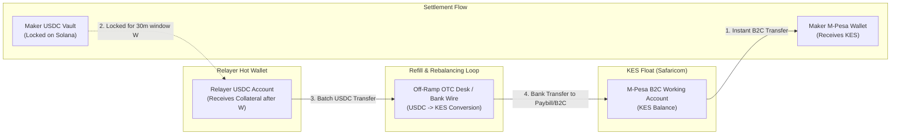

<!-- OPENWIKI:START -->
# Liquidity & Treasury Architecture (`bamboo-relayer`)

## 1. Capital Architecture & Float Mechanics

In Project Bamboo v1, the reference relayer operates on an **asymmetric liquidity pre-funding model**: the relayer disburses sovereign domestic fiat (KES) immediately upon on-chain lock detection, whereas the offsetting crypto collateral (USDC) is only unlocked into the relayer’s wallet after the challenge window ($W = 30\text{ minutes}$) completes.



### 1.1 Where the Float Sits
1. **Asset:** Kenyan Shillings (KES).
2. **Custody:** Safaricom M-Pesa B2C Working Account linked directly to the reference relayer's corporate Paybill / Bulk Disbursement shortcode.
3. **Ownership:** 100% owned and capitalized by the reference relayer legal operating entity.
4. **Availability:** Dedicated liquid balance reserved solely for automated API disbursements.

---

## 2. Working Capital Cycle & Numeric Example

### 2.1 The Exposure Window
The relayer's working capital is exposed for **two distinct horizons**:
1. **On-Chain Risk Window ($W = 30\text{ minutes}$):** The period during which locked USDC cannot be moved while awaiting maker dispute clearance.
2. **Treasury Refill Latency ($4\text{ to }24\text{ hours}$):** The operational delay required to batch settled USDC, sell it for KES via an OTC desk or exchange, and clear the fiat wire back into the Safaricom B2C shortcode.

### 2.2 Worked Numeric Example (100 USDC Order)
Assume an honest maker executes an off-ramp order of **100 USDC**:

| Step | Time | Relayer Action | Balance Changes |
|---|---|---|---|
| **Quote & Lock** | $T_0$ | Relayer quotes USD/KES = 130.50, fee = 20 bps ($0.20 USDC). Maker locks 100 USDC on Solana. | Escrow Vault: $+100.00\text{ USDC}$ |
| **Fiat Disbursement** | $T_0 + 15\text{s}$ | Relayer verifies finalized lock and executes Daraja B2C payment to user's phone. | M-Pesa Float: $-\text{KES }13{,}050$<br>Safaricom B2C Fee: $-\text{KES }60.00$ |
| **Dispute Window** | $T_0 + 15\text{s} \to T_0 + 1815\text{s}$ | Relayer submits `request_settlement`. Waits 30 minutes ($W$). Maker confirms receipt; no dispute. | No balance movement (Funds frozen on-chain). |
| **Finalization** | $T_0 + 1816\text{s}$ | Relayer executes `finalize(order_id)`. Receives 100 USDC. | Relayer Hot Wallet: $+100.00\text{ USDC}$<br>Escrow Vault: Closed ($0\text{ USDC}$) |
| **Float Refill** | $T_0 + 6\text{h}$ | Relayer batches 10,000 USDC to an institutional OTC desk at 131.20 KES, receiving bank wire into Safaricom shortcode. | M-Pesa Float: $+\text{KES }1{,}312{,}000$<br>Hot Wallet: $-10{,}000\text{ USDC}$ |

**Resulting Net Exposure:** During the 6-hour refill cycle, the relayer float absorbed $\text{KES }13{,}110$ of cash outflow before capital was recycled.

---

## 3. Float Sizing Logic & Risk Limits

To guarantee that the relayer never runs dry or exhausts float during peak volume spikes, the required M-Pesa working float ($F_{\text{required}}$) is calculated as:

$$F_{\text{required}} = (\text{Peak Hourly Volume}) \times (\text{Treasury Refill Hours}) \times (\text{Safety Buffer Multiplier})$$

### Recommended v1 Parameters:
- **Assumed Daily Volume:** 10,000 USDC / day ($\approx \text{KES }1{,}305{,}000$).
- **Refill Latency:** 12 hours (banking cutoff safety buffer).
- **Safety Multiplier:** $1.5\times$.
- **Minimum Target Float:**
  $$F_{\text{min}} = \left(\frac{1{,}305{,}000}{24} \times 12\right) \times 1.5 \approx \mathbf{\text{KES }980{,}000} \approx \mathbf{\$7{,}500\text{ USDC}}$$

### Per-Order and Daily Velocity Limits

| Parameter | Limit | Mechanism / Enforcement |
|---|---|---|
| **Minimum Order Size** | $10\text{ USDC}$ ($\approx \text{KES }1{,}305$) | Enforced on-chain and in RFQ engine to prevent sub-economic dust griefing. |
| **Maximum Order Size** | $500\text{ USDC}$ ($\approx \text{KES }65{,}250$) | Enforced on-chain. Fits within Safaricom's KES 150,000 per-transaction cap. |
| **Daily Volume Cap** | $10{,}000\text{ USDC} / \text{day}$ | Relayer daemon refuses quotes once rolling 24h volume threshold is met. |
| **Float Exhaustion Threshold** | $\text{KES }100{,}000$ | If float falls below KES 100,000, `/rfq/quote` returns HTTP 503 "Float Capacity Depleted". |

---

## 4. Float Refill & Treasury Options (OPEN DECISION)

Converting received USDC back into KES to refill the M-Pesa B2C working account requires an active banking/liquidity partner in Kenya.

### Evaluated Refill Routes:

| Route | Execution Mechanics | Speed | Regulatory Implications | Recommendation Status |
|---|---|---|---|---|
| **A. Licensed Domestic Bank / OTC Partner** | Sell USDC via an institutional wholesale OTC desk (e.g. Yellow Card, Onafriq, or local commercial bank treasury) delivering KES directly to Safaricom Paybill via RTGS. | 2–6 hours | Cleanest regulatory posture; counterparties hold VASP/CBK licenses; source of funds fully documented. | **RECOMMENDED FOR PRODUCTION** |
| **B. Regulated Global Exchange** | Sell USDC for USD on Coinbase/Kraken, wire USD via SWIFT to local Kenyan bank account, convert to KES, transfer to Safaricom. | 24–48 hours | High banking friction; SWIFT wire delays and correspondent banking fees make micro-refills uneconomic. | Viable only for large bi-weekly treasury rebalancing ($>\$50\text{k}$). |
| **C. P2P Merchant Network** | Disburse USDC to vetted local liquidity merchants in exchange for direct M-Pesa float transfers. | 15–30 mins | Extreme AML/KYC risk; personal M-Pesa accounts subject to Safaricom fraud freezes; high counterparty risk. | **REJECTED** |

> **Open Decision:** The specific corporate banking partner and OTC counterparty for KES treasury refilling must be finalized prior to production launch. *(See `docs/plan/50-open-decisions.md`).*

---

## 5. Unit Economics Under the 25 bps Protocol Fee Ceiling

### 5.1 Official Cost Breakdown (Kenyan Shillings & USDC)
- **Safaricom M-Pesa B2C Tariffs (Official Tariffs):**
  - KES 101 – 500: KES 10.00
  - KES 501 – 1,000: KES 15.00
  - KES 1,001 – 2,500: KES 25.00
  - KES 2,501 – 5,000: KES 35.00
  - KES 5,001 – 10,000: KES 45.00
  - KES 10,001 – 20,000: KES 60.00
  - KES 20,001 – 50,000: KES 110.00
- **Solana Transaction Fees:** 5,000 lamports ($\approx 0.000005\text{ SOL} \approx \$0.001$).
- **OTC Conversion Spread:** $0.50\%\text{ to }0.75\%$ on wholesale USDC $\to$ KES conversion.

### 5.2 The 25 bps Ceiling Economic Reality
Under the on-chain protocol fee ceiling of **25 bps ($0.25\%$)**:
- A **100 USDC order** yields an on-chain fee of:
  $$100 \times 0.0025 = \mathbf{\$0.25\text{ USDC}} \approx \mathbf{\text{KES }32.60}$$
- However, Safaricom's B2C tariff for KES 13,050 is **KES 60.00 ($0.46 USDC)**!
- **Gross Loss:** The relayer loses $\text{KES }27.40$ on the transaction if it relies exclusively on the on-chain host fee.

### 5.3 Break-Even Analysis & Economic Solution

```
Break-Even Equation:
  On-Chain Fee (0.25%) >= Safaricom Tariff + Gas
  For Ticket = 500 USDC (KES 65,250):
    Fee = 500 * 0.0025 = $1.25 (KES 163.12)
    Safaricom Tariff = KES 180.00 ($1.38)
    Net: Relayer still loses KES 16.88.
```

### Commercial Architecture Decision:
To remain solvent while adhering to the immutable on-chain fee ceiling of 25 bps, **the relayer's business model incorporates an operational spread into the quoted exchange rate**:
1. **On-Chain Fee:** Fixed at $\le 25\text{ bps}$ ($0.25\%$), transparently routed by the smart contract.
2. **Quoted FX Spread:** The relayer sets its RFQ rate at wholesale spot minus $1.0\%\text{ to }1.5\%$. This spread absorbs Safaricom's fixed B2C tariffs, treasury conversion costs, and float capital cost, while still delivering retail users pricing superior to traditional card off-ramps ($4\%\text{ to }8\%$).

---

## 6. Multi-Relayer Scaling Roadmap (v3+)

When transitioning from the single reference relayer to an open relayer network:
- Relayers will stake an on-chain slashable security bond in a registry contract.
- Liquid order matching will transition from centralized RFQs to on-chain Dutch auctions or decentralized request-for-quotes.
- Competing relayers will post float locally across regional jurisdictions (M-Pesa, Pix, SEPA Instant), competing purely on FX spread and execution speed.

<!-- OPENWIKI:END -->
