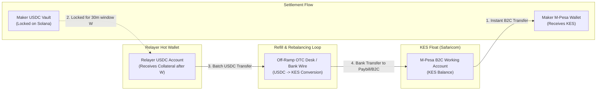

<!-- OPENWIKI:START -->
# Liquidity & Treasury Architecture (`bamboo-relayer`)

## 1. Capital Architecture & Float Mechanics

In Project Bamboo v1, the reference relayer operates on an **asymmetric liquidity pre-funding model**: the relayer disburses sovereign domestic fiat (KES) immediately upon on-chain lock detection, whereas the offsetting crypto collateral (USDC) is only unlocked into the relayer’s wallet after the challenge window ($W = 30\text{ minutes}$) completes.

### 1.1 Where the Float Sits
1. **Asset:** Kenyan Shillings (KES).
2. **Custody:** Safaricom M-Pesa B2C Working Account linked directly to the reference relayer's corporate Paybill / Bulk Disbursement shortcode.
3. **Ownership:** 100% owned and capitalized by the reference relayer legal operating entity.
4. **Availability:** Dedicated liquid balance reserved solely for automated API disbursements.

---

## 2. Working Capital Cycle & Numeric Example

### 2.1 The Exposure Window
The relayer's working capital is exposed for **two distinct horizons**:
1. **On-Chain Risk Window ($W = 30\text{ minutes}$):** The period during which locked USDC cannot be moved while awaiting maker dispute clearance.
2. **Treasury Refill Latency ($4\text{ to }24\text{ hours}$):** The operational delay required to batch settled USDC, sell it for KES via an OTC desk or exchange, and clear the fiat wire back into the Safaricom B2C shortcode.

### 2.2 Worked Numeric Example (100 USDC Order)
Assume an honest maker executes an off-ramp order of **100 USDC**:

| Step | Time | Relayer Action | Balance Changes |
|---|---|---|---|
| **Quote & Lock** | $T_0$ | Relayer quotes USD/KES = 130.50, fee = 20 bps ($0.20 USDC). Maker locks 100 USDC on Solana. | Escrow Vault: $+100.00\text{ USDC}$ |
| **Fiat Disbursement** | $T_0 + 15\text{s}$ | Relayer verifies finalized lock and executes Daraja B2C payment to user's phone for $(100 - 0.20) \times 130.50 = \text{KES }13{,}023.90$. | M-Pesa Float: $-\text{KES }13{,}023.90$ Safaricom B2C Fee: $-\text{KES }11.00$ |
| **Dispute Window** | $T_0 + 15\text{s} \to T_0 + 1815\text{s}$ | Relayer submits `request_settlement`. Waits 30 minutes ($W$). Maker confirms receipt; no dispute. | No balance movement (Funds frozen on-chain). |
| **Finalization** | $T_0 + 1816\text{s}$ | Relayer or permissionless caller executes `finalize(order_id)`. Relayer receives 100 USDC (99.80 principal + 0.20 host fee). | Relayer Hot Wallet: $+100.00\text{ USDC}$ Escrow Vault: Closed ($0\text{ USDC}$) |
| **Float Refill** | $T_0 + 6\text{h}$ | Relayer liquidates USDC via OTC desk at wholesale rate 129.85 KES (50 bps spread off 130.50 spot), wiring KES back into Paybill. | M-Pesa Float: $+\text{KES }1{,}298{,}500$ Hot Wallet: $-10{,}000\text{ USDC}$ |

**Resulting Net Exposure:** During the 6-hour refill cycle, the relayer float absorbed $\text{KES }13{,}034.90$ of cash outflow before capital was recycled.

---

## 3. Float Sizing Logic & Risk Limits

To guarantee that the relayer never runs dry or exhausts float during peak volume spikes, the required M-Pesa working float ($F_{\text{required}}$) is calculated as:

$$F_{\text{required}} = (\text{Peak Hourly Volume}) \times (\text{Treasury Refill Hours}) \times (\text{Safety Buffer Multiplier})$$

Where $\text{Peak Hourly Volume} = \left(\frac{\text{Daily Volume}}{24}\right) \times \text{Peak Multiplier}$ (typically $2.0\times\text{ to }3.0\times$ during peak daytime operating hours in East Africa).

### Recommended v1 Parameters:
- **Assumed Daily Volume:** 10,000 USDC / day ($\approx \text{KES }1{,}305{,}000$).
- **Refill Latency:** 12 hours (banking cutoff safety buffer).
- **Safety Multiplier:** $1.5\times$.
- **Target Minimum Working Float:**
  $$F_{\text{min}} = \left(\frac{1{,}305{,}000}{24} \times 2.0 \times 12\right) \times 1.5 \approx \mathbf{\text{KES }1{,}957{,}500} \approx \mathbf{\$15{,}000\text{ USDC}}$$

### Per-Order and Daily Velocity Limits

| Parameter | Limit | Mechanism / Enforcement |
|---|---|---|
| **Minimum Order Size** | $10\text{ USDC}$ ($\approx \text{KES }1{,}305$) | Enforced on-chain and in RFQ engine to prevent sub-economic dust griefing. |
| **Maximum Order Size** | $500\text{ USDC}$ ($\approx \text{KES }65{,}250$) | Enforced on-chain. Fits within Safaricom's KES 250,000 per-transaction B2C cap. |
| **Daily Volume Cap** | $10{,}000\text{ USDC} / \text{day}$ | Relayer daemon refuses quotes once rolling 24h volume threshold is met. |
| **Float Exhaustion Threshold** | $\text{KES }100{,}000$ | If float falls below KES 100,000, `/rfq/quote` returns HTTP 503 "Float Capacity Depleted". |

---

## 4. Float Refill & Treasury Options (OPEN DECISION)

Converting received USDC back into KES to refill the M-Pesa B2C working account requires an active banking/liquidity partner in Kenya.

### Evaluated Refill Routes:

| Route | Execution Mechanics | Speed | Regulatory Implications | Recommendation Status |
|---|---|---|---|---|
| **A. Licensed Domestic Bank / OTC Partner** | Sell USDC via an institutional wholesale OTC desk (e.g. Yellow Card, Onafriq, or local commercial bank treasury) delivering KES directly to Safaricom Paybill via RTGS. | 2–6 hours | Cleanest regulatory posture; counterparties hold VASP/CBK licenses; source of funds fully documented. | **RECOMMENDED FOR PRODUCTION** |
| **B. Regulated Global Exchange** | Sell USDC for USD on Coinbase/Kraken, wire USD via SWIFT to local Kenyan bank account, convert to KES, transfer to Safaricom. | 24–48 hours | High banking friction; SWIFT wire delays and correspondent banking fees make micro-refills uneconomic. | Viable only for large bi-weekly treasury rebalancing ($>\$50\text{k}$). |
| **C. P2P Merchant Network** | Disburse USDC to vetted local liquidity merchants in exchange for direct M-Pesa float transfers. | 15–30 mins | Extreme AML/KYC risk; personal M-Pesa accounts subject to Safaricom fraud freezes; high counterparty risk. | **REJECTED** |

> [!IMPORTANT]
> The specific corporate banking partner and wholesale OTC counterparty for KES treasury refilling must be confirmed with signed rate cards prior to production deployment.

---

## 5. Verified Unit Economics & Fee Breakdown

### 5.1 Official Safaricom B2C Bulk Payment Tariffs
Source: *Safaricom M-PESA Bulk Payment Tariff Form* (B2C registered users, customer charge = KES 0):

| Payout Bracket (KES) | Business Charge (KES) | Effective Cost on Median ($) | Effective Basis Points |
|---|---|---|---|
| **101 – 1,500** | KES 5.00 | $\approx \$10$ order | **~39 bps** |
| **1,501 – 5,000** | KES 9.00 | $\approx \$25$ order | **~28 bps** |
| **5,001 – 20,000** | KES 11.00 | $\approx \$100$ order | **~8.5 bps** |
| **20,001 – 250,000** | KES 13.00 | $\approx \$500$ order | **~2.0 bps** |

*Note: Transaction maximum for bulk B2C disbursement is KES 250,000 per transaction.*

### 5.2 Real Unit Cost Structure
At tickets $\ge \$50$, Safaricom's B2C tariff is **not the primary margin bottleneck** — a 25 bps host fee easily absorbs the 2–8.5 bps B2C transaction cost.

Instead, overall net profitability is driven by four primary operational factors:
1. **Wholesale OTC Refill Spread (USDC $\to$ KES):** Converting settled USDC to replenish domestic Paybill float typically costs 25 to 75 bps depending on counterparty tier.
2. **Kenyan Virtual Asset Excise Duty:** Under the Kenya Finance Act 2025 (effective 1 July 2025), a **10% excise duty** applies to fees charged by virtual asset service providers.
3. **Dispute & Fraud Loss Reserve:** Provisioning 5–15 bps for edge-case chargebacks or unresolved disputes.
4. **Small-Ticket Drag:** For tickets $<\$20$, the fixed KES 5.00 minimum charge ($\approx 39\text{ bps}$) exceeds the 25 bps protocol ceiling unless buffered by a minimum ticket size or an exchange spread.

### 5.3 Per-Order Margin Breakdown ($100 Ticket Benchmark)

$$\text{Net Margin} = (\text{Host Fee} + \text{FX Spread}) - [\text{B2C Fee} + \text{OTC Refill Spread} + \text{Excise Duty} + \text{Fraud Loss} + \text{Float Cost}]$$

At a **$100 Ticket** (KES 13,050 payout):
- **Safaricom B2C Charge:** KES 11.00 ($\approx 8.5\text{ bps}$).
- **OTC Refill Cost:** $\approx 50\text{ bps}$ (at standard institutional clip).
- **Excise Duty (10% on fees):** $\approx 2.5\text{ to }10\text{ bps}$.
- **Fraud/Dispute Provision:** $\approx 5\text{ bps}$.
- **Float Holding Cost (12h cycle):** $\approx 1.5\text{ bps}$.

| All-In Customer Price | Net Margin (bps) | Economic Viability |
|---|---|---|
| **0.25% (Fee Only, 0 Spread)** | **-43 bps** | Net Loss (Unviable without fee adjustment) |
| **0.50%** | **-20 bps** | Sub-economic |
| **0.75%** | **+2 bps** | Break-even |
| **1.00%** | **+25 bps** | Healthy sustainable margin |
| **1.20% (20 bps fee + 100 bps spread)** | **+43 bps** | Highly profitable, 3–4x cheaper than cards/P2P |

### 5.4 Economic Architecture Recommendations
1. **Refill Leg Optimization:** Solicit quotes from $\ge 3$ domestic liquidity desks (e.g. Yellow Card, Onafriq, Stanbic Treasury) targeting refill execution at $\le 25\text{ bps}$.
2. **Minimum Ticket Threshold:** Maintain a minimum ticket floor of $20\text{ to }25\text{ USDC}$ to prevent sub-economic B2C fixed fee erosion.
3. **Transparent All-In Pricing:** Package fee and quoted FX spread into a single, predictable all-in price (~0.75% to 1.00%) delivering clear consumer savings over card off-ramps (4–7%) and P2P merchants (2–4%).

---

## 6. Multi-Relayer Scaling Roadmap (v3+)

When transitioning from the single reference relayer to an open relayer network:
- Relayers will stake an on-chain slashable security bond in a registry contract.
- Liquid order matching will transition from centralized RFQs to on-chain Dutch auctions or decentralized request-for-quotes.
- Competing relayers will post float locally across regional jurisdictions (M-Pesa, Pix, SEPA Instant), competing purely on FX spread and execution speed.

<!-- OPENWIKI:END -->
