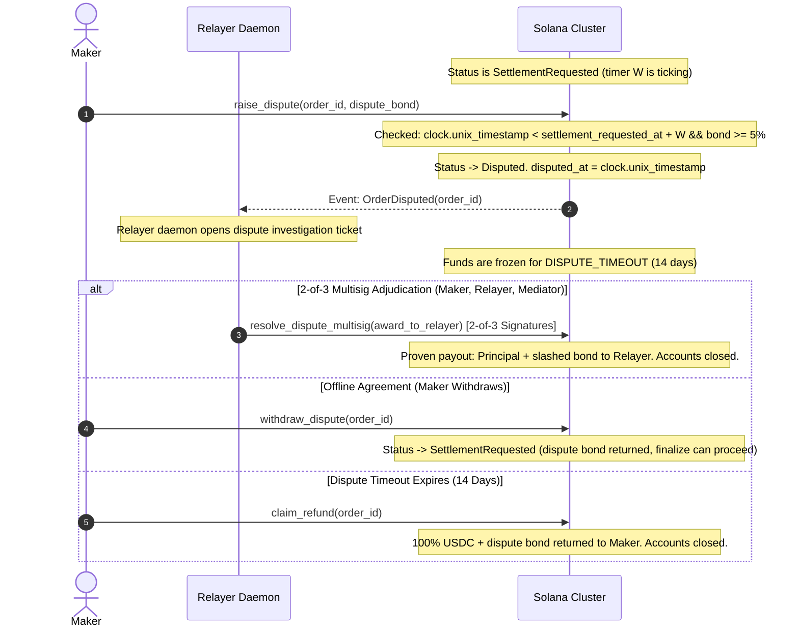
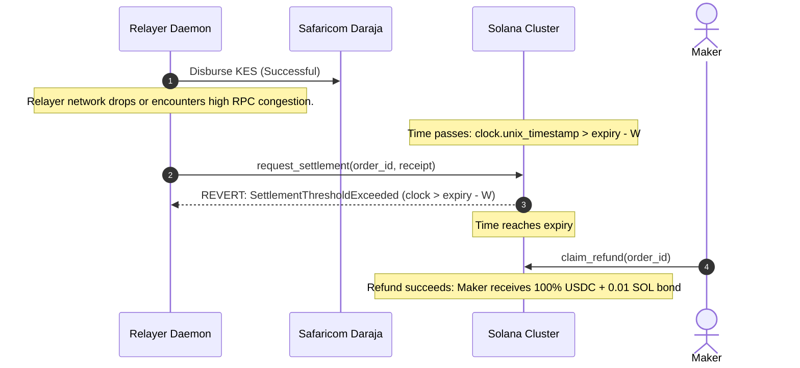
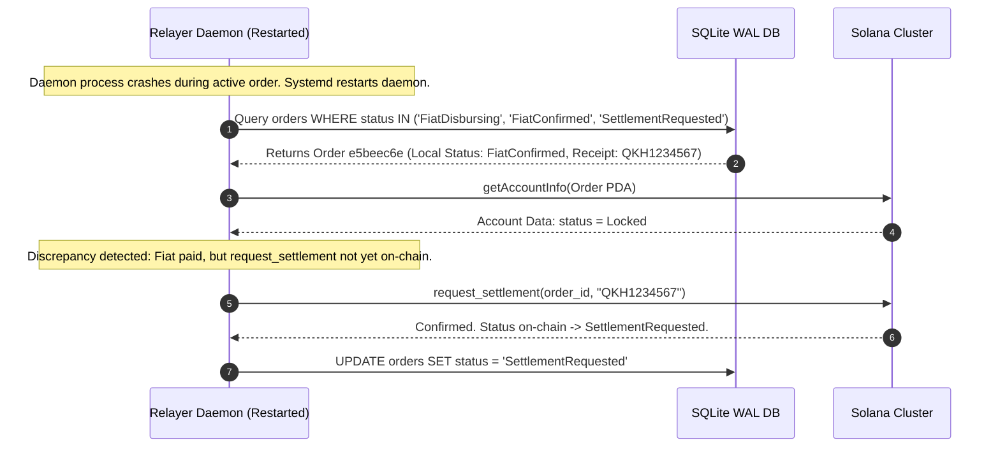

<!-- OPENWIKI:START -->
# Integration & Settlement Flows

## 1. System-Wide State Mapping

Project Bamboo v1 enforces strict consistency across three distinct state storage systems: the **Solana On-Chain Account State**, the **Relayer Relational Database**, and the **Double-Entry Financial Ledger**.

| On-Chain Status (`bamboo_escrow`) | Relayer DB Status (`orders.status`) | Ledger Journal State | Single Source of Truth | Money-Safety Invariant |
|---|---|---|---|---|
| *None* | `QuoteCreated` | *No entry* | Relayer DB | No funds locked. Rate quote valid for 7 seconds. |
| `Locked` | `LockDetected` | *Memorandum* | Solana Escrow PDA | Maker's USDC and 0.01 SOL bond safely custodied in on-chain vault. |
| `Locked` | `FiatDisbursing` | *Memorandum* | Relayer DB | Relayer attempting fiat transfer; on-chain funds remain locked. |
| `Locked` | `FiatConfirmed` | Debit `ESCROW_REC_KES`<br>Credit `MPESA_FLOAT` | Daraja / Relayer DB | Fiat has cleared to maker's phone. Relayer holds M-Pesa receipt. |
| `SettlementRequested` | `SettlementRequested` | *Active Timer* | Solana Escrow PDA | Relayer has posted M-Pesa receipt on-chain; challenge window $W$ is active. |
| `Disputed` | `Disputed` | *Frozen Asset* | Solana Escrow PDA | Maker flagged non-receipt. Settlement frozen on-chain. |
| `Finalized` | `Finalized` | Debit `RELAYER_USDC`<br>Credit `ESCROW_REC`<br>Credit `FEE_REVENUE` | Solana Escrow PDA | Terminal state: USDC transferred to relayer; bond returned to maker; accounts closed. |
| `Refunded` | `Refunded` | *Reversal / Write-Off* | Solana Escrow PDA | Terminal state: 100% USDC and bond returned to maker; accounts closed. |

---

## 2. Settlement Scenarios & Sequence Diagrams

### Flow 1: Happy Path (End-to-End Payout & Finalization)
```mermaid
sequenceDiagram
    autonumber
    actor Maker as Maker / User App
    participant Relayer as Relayer Daemon
    participant Solana as Solana Cluster
    participant Daraja as Safaricom Daraja
    participant UserMpesa as Maker M-Pesa Wallet

    Maker->>Relayer: POST /rfq/quote (100 USDC -> KES)
    Relayer-->>Maker: 200 OK (Quote: 130.50 KES, host_fee: 20 bps, sig)
    
    Maker->>Solana: lock_order(nonce, 100 USDC, fiat_hash, duration=3600, fee=20)
    Note over Solana: USDC transferred to Vault; 0.01 SOL bond deposited
    Solana-->>Relayer: Event: OrderLocked (Finalized commitment)
    
    Relayer->>Daraja: POST /mpesa/b2c/v1/paymentrequest (KES 13,050)
    Daraja->>UserMpesa: Disburse KES 13,050
    UserMpesa-->>Daraja: Credit Confirmed
    Daraja->>Relayer: Callback: ResultCode 0 (Receipt: QKH1234567)
    
    Relayer->>Solana: request_settlement(order_id, "QKH1234567")
    Note over Solana: Status -> SettlementRequested. Timer W (1800s) started.
    
    Note over Maker,Relayer: 30-Minute Challenge Window W Elapses Without Dispute
    
    Relayer->>Solana: finalize(order_id)
    Note over Solana: Vault -> Relayer (100 USDC); Bond -> Maker (0.01 SOL); Accounts Closed
    Solana-->>Relayer: Event: OrderFinalized
```
- **Persisted Before Step 4:** DB records `FiatDisbursing`.
- **Persisted After Step 7:** DB records `FiatConfirmed`, ledger records KES debit.
- **Money Safety Property:** The maker holds KES; the relayer receives USDC only after $W$ passes.

---

### Flow 2: Maker Disputes Within Challenge Window

- **Money Safety Property:** A fraudulent relayer assertion does not immediately seize funds; the maker has an un-bypassable window $W$ to freeze escrow, while the dispute bond prevents false dispute extortion.

---

### Flow 3: Relayer Never Pays (Order Expiry Refund)
```mermaid
sequenceDiagram
    autonumber
    actor Maker as Maker
    participant Relayer as Relayer Daemon
    participant Solana as Solana Cluster

    Maker->>Solana: lock_order(...)
    Note over Solana: Order locked with expiry = T0 + 3600s
    
    Note over Relayer: Relayer offline or float exhausted; no fiat disbursed.
    Note over Solana: Clock passes expiry (clock >= expiry)
    
    Maker->>Solana: claim_refund(order_id)
    Note over Solana: Checked: status == Locked && clock >= expiry
    Note over Solana: Transfers 100% USDC back to Maker; refunds 0.01 SOL bond; closes accounts.
    Solana-->>Maker: Refund Confirmed
```
- **Money Safety Property:** If the relayer fails to perform, the maker recovers 100% of principal, interest-free, minus Solana network gas.

---

### Flow 4: Relayer Pays Fiat but Submits Late Settlement

- **Vulnerability / Consequence:** Maker receives both fiat KES and crypto refund.
- **Relayer Loss Mitigation:** Relayer enforces an internal cut-off: if an order cannot be disbursed and confirmed with at least **$2\times W$** remaining before expiry, the relayer refuses to dispatch fiat and allows the order to expire cleanly.

---

### Flow 5: Daraja Webhook Callback Lost or Delayed
```mermaid
sequenceDiagram
    autonumber
    participant Relayer as Relayer Daemon
    participant Daraja as Safaricom Daraja

    Relayer->>Daraja: POST /mpesa/b2c/v1/paymentrequest
    Daraja-->>Relayer: 200 OK (Accepted into Queue)
    Note over Daraja: Internet routing failure; ResultURL callback is lost.
    
    Note over Relayer: 90-Second Timeout Expires
    Relayer->>Daraja: POST /mpesa/transactionstatus/v1/query (OriginatorConversationID)
    Daraja-->>Relayer: 200 OK (Status: Completed, Receipt: QKH1234567)
    
    Note over Relayer: Relayer recovers receipt and proceeds to on-chain settlement.
```
- **Money Safety Property:** Status queries prevent duplicate disbursements for lost callbacks.

---

### Flow 6: Relayer Daemon Crash Mid-Order & Restart Recovery


---

### Flow 7: Solana RPC Congestion / Dropped Transactions
```mermaid
sequenceDiagram
    autonumber
    participant Relayer as Relayer Daemon
    participant RPC as Solana RPC Node
    participant Cluster as Solana Validator Cluster

    Relayer->>RPC: sendTransaction(request_settlement)
    RPC-->>Relayer: Signature: 4vJ9...
    
    Note over Cluster: Network congestion drops UDP packet; transaction not included in block.
    
    Relayer->>RPC: getSignatureStatus(4vJ9..., searchTransactionHistory=true)
    RPC-->>Relayer: Status: null (Not Found)
    
    Note over Relayer: Exponential Backoff (2s, 4s, 8s)
    Relayer->>RPC: sendTransaction(request_settlement) [Same parameters and recent blockhash]
    RPC-->>Relayer: Signature: 5kL2...
    Relayer->>RPC: confirmTransaction(5kL2..., finalized)
    RPC-->>Relayer: Confirmed in block 28910293
```
- **Money Safety Property:** Idempotent transaction retry logic prevents stalled settlement without altering order parameters.

<!-- OPENWIKI:END -->
