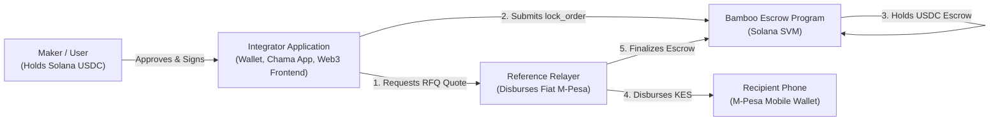

<!-- OPENWIKI:START -->
# Third-Party Integrator Guide: Project Bamboo v1

## 1. Overview & Architecture

Project Bamboo is an open, permissionless off-ramp settlement protocol built on the Solana blockchain. Any decentralized application, non-custodial wallet, savings group (chama/SACCO) tool, or merchant platform can integrate Bamboo to enable instant off-ramping from USDC to domestic mobile money (M-Pesa KES).

### Participant Roles



1. **Maker (User):** The owner of crypto funds who signs the Solana transaction to lock collateral.
2. **Integrator App:** Any client software that interfaces between the user, the Bamboo Solana program, and the reference relayer.
3. **Reference Relayer:** The liquidity node (operated in v1 by the protocol team) that provides exchange rate quotes, receives fiat recipient details via encrypted TLS, and disburses local mobile money.

---

## 2. Integration Surface: Technical Specifications

### 2.1 On-Chain Interface (Solana Anchor Program)
- **Program ID (Devnet):** `BamEscrow1111111111111111111111111111111111`
- **Supported Token Mint:** USDC (Devnet: `4zMMC9srt5Ri5X14GAgXhaHii3GnPAEERYPJgZJDncDU`, Mainnet: `EPjFWdd5AufqSSqeM2qN1xzybapC8G4wEGGkZwyTDt1v`)
- **Required Instruction:** `lock_order`

#### Minimal TypeScript Client Snippet
```typescript
import { Program, BN, web3 } from "@coral-xyz/anchor";
import { PublicKey } from "@solana/web3.js";
import { createHash, randomBytes } from "crypto";

// 1. Generate 32-byte salt and compute recipient hash
const salt = randomBytes(32);
const recipientPhone = "254712345678"; // E.164 format without '+'
const hasher = createHash("sha256");
hasher.update("BAMBOO_FIAT_V1");
hasher.update(recipientPhone);
hasher.update(salt);
const fiatRecipientHash = hasher.digest();

// 2. Derive Order PDA: seeds = ['order', maker, nonce]
const nonce = new BN(Date.now());
const [orderPda] = PublicKey.findProgramAddressSync(
  [Buffer.from("order"), makerPubkey.toBuffer(), nonce.toArrayLike(Buffer, "le", 8)],
  program.programId
);

// 3. Dispatch lock_order transaction
const tx = await program.methods
  .lockOrder(
    nonce,
    new BN(100_000_000), // 100.000000 USDC (6 decimals)
    Array.from(fiatRecipientHash),
    new BN(3600),        // duration: 1 hour (>= 900s)
    20                   // host_fee_bps: 20 bps (<= 25 bps)
  )
  .accounts({
    maker: makerPubkey,
    assignedRelayer: relayerPubkey,
    tokenMint: usdcMintPubkey,
    makerTokenAccount: makerAta,
  })
  .rpc();
```

---

### 2.2 Relayer HTTP API Reference

Base URL (Devnet): `https://devnet-relayer.bamboo.network`

#### 1. Request RFQ Quote
- **Endpoint:** `POST /rfq/quote`
- **Rate Limit:** 60 requests / minute per IP
- **Request:**
  ```json
  {
    "chain": "solana",
    "token": "EPjFWdd5AufqSSqeM2qN1xzybapC8G4wEGGkZwyTDt1v",
    "amount": 100000000,
    "fiat_currency": "KES"
  }
  ```
- **Response:**
  ```json
  {
    "quote_id": "8f8b8e01-9a72-4d12-8e12-82f7c00e1234",
    "crypto_amount": 100000000,
    "fiat_amount": 13050,
    "fiat_currency": "KES",
    "exchange_rate": 130.50,
    "host_fee_bps": 20,
    "valid_for_seconds": 7,
    "signature": "3c8f...ed25519"
  }
  ```

#### 2. Register Order Recipient Details (Pre-Lock Registration)
Before broadcasting the on-chain lock, the integrator posts the private recipient phone number and salt securely over TLS to the relayer:
- **Endpoint:** `POST /orders/register`
- **Request:**
  ```json
  {
    "quote_id": "8f8b8e01-9a72-4d12-8e12-82f7c00e1234",
    "maker": "7nYx...maker",
    "nonce": 1727600000,
    "recipient_phone": "254712345678",
    "salt_hex": "4a7b...32bytes",
    "fiat_recipient_hash_hex": "e5be...32bytes"
  }
  ```
- **Response:** `200 OK {"status": "registered", "expected_order_id": "e5beec6e..."}`

---

## 3. Step-by-Step "Integrate in One Afternoon" Walkthrough

```
Step 1: Request Quote ----> Step 2: Register Hash ----> Step 3: Sign Solana Lock
          |                           |                             |
      User sees                   Phone/Salt                     On-Chain Vault
    100 USDC = KES 13,050       sent via TLS                   Custodies Funds
                                                                    |
Step 6: Payout Completed <-- Step 5: Challenge Window <-- Step 4: M-Pesa Sent
          |                           |                             |
    Accounts Closed             User can dispute               User receives
    USDC -> Relayer               if unpaid                      M-Pesa SMS
```

### Walkthrough Checklist:
1. **Get Quote:** Call `POST /rfq/quote`. Display net KES to user with 7-second countdown.
2. **Compute Recipient Hash:** Generate 32 cryptographically secure random bytes for `salt`. Compute SHA-256 over `BAMBOO_FIAT_V1 || phone || salt`.
3. **Register With Relayer:** Submit `phone`, `salt`, and `hash` to `POST /orders/register`.
4. **Broadcast Lock:** Submit `lock_order` to Solana with 0.01 SOL bond.
5. **Poll Status:** Subscribe to Solana program events or poll `GET /orders/status/:order_id` on the relayer daemon.
6. **Handle Dispute/Refund (Edge Cases):** If the relayer posts an invalid receipt or does not disburse fiat within $W$, present a "Dispute Transaction" button to the user.

---

## 4. Recipient Privacy Architecture

### The Privacy Problem & Vulnerability in Naive Designs
Kenyan mobile phone numbers conform to Safaricom's MSISDN format: `2547XXXXXXXX` or `2541XXXXXXXX` (approximately $50\text{ million}$ possible combinations). 
> **Critical Privacy Flaw:** If a phone number is hashed with a static seed or if the salt is generated by the relayer, an external observer can compute a rainbow table of all 50 million phone numbers in **under 3 seconds**, permanently de-anonymizing every maker's real-world identity on the public blockchain!

### The Bamboo v1 Salted Privacy Solution
1. **Maker-Controlled Random Salt:** The integrator app MUST generate a unique, cryptographically secure 32-byte pseudo-random salt (`crypto.getRandomValues(new Uint8Array(32))`) for every single order.
2. **Preimage Construction:**
   $$\text{fiat\_recipient\_hash} = \text{SHA256}(\text{"BAMBOO\_FIAT\_V1"} \parallel \text{phone\_e164} \parallel \text{salt})$$
3. **Information Disclosure Boundary:**
   - **Public Blockchain:** Contains only the 32-byte SHA-256 hash. Because the salt possesses 256 bits of entropy, rainbow table attacks and brute-force searches are mathematically impossible.
   - **Encrypted Relayer Channel:** The plaintext phone number and salt are transmitted solely to the committed reference relayer over TLS.
   - **Dispute Resolution:** In the event of a disputed transaction, the maker publishes the salt to prove to any independent observer that the order was bound to their specific phone number.

---

## 5. UI/UX Status Mapping Table for Integrators

Integrator applications should display human-readable status indicators based on on-chain state:

| On-Chain Status | User-Facing UI Label | Recommended User Guidance | Action Available |
|---|---|---|---|
| *Pending Tx* | "Locking Escrow..." | Waiting for Solana transaction finalization. | None |
| `Locked` | "Processing Payout..." | Escrow locked. M-Pesa disbursement in progress. | None |
| `SettlementRequested` | "Payment Sent via M-Pesa" | Check M-Pesa SMS. Funds releasing in 30 minutes. | **"I Didn't Receive It" (Dispute)** |
| `Disputed` | "Payment Disputed" | Funds frozen pending support investigation. | Contact Support |
| `Finalized` | "Completed" | Payout confirmed and settled successfully. | View Receipt |
| `Refunded` | "Refunded" | Escrow expired without payout. Principal returned. | Withdraw Refund |

---

## 6. Integrator Responsibilities & Disclaimers

1. **KYC / AML Compliance:** Bamboo v1 is an open settlement protocol and does not perform consumer identity verification. Integrators are solely responsible for compliance with local AML/CFT laws, transaction reporting thresholds, and Sanctions regulations applicable in their jurisdiction.
2. **Integrator Markup Policy:** Integrators may charge client-side service fees (e.g., 10–50 bps) in their own application layer, but MUST NOT alter or tamper with the on-chain `host_fee_bps` parameter ($\le 25\text{ bps}$) intended for the relayer.
3. **Trust Model Disclaimer:** Integrators must disclose to end users that Bamboo v1 relies on a reference relayer for local fiat disbursement backed by on-chain timelock dispute mechanics, not trustless zero-knowledge hardware.

---

## 7. Devnet Sandbox Testing Environment

| Parameter | Devnet Value |
|---|---|
| **Solana RPC** | `https://api.devnet.solana.com` |
| **Escrow Program ID** | `BamEscrow1111111111111111111111111111111111` |
| **Devnet USDC Mint** | `4zMMC9srt5Ri5X14GAgXhaHii3GnPAEERYPJgZJDncDU` |
| **Reference Relayer URL** | `https://devnet-relayer.bamboo.network` |
| **Safaricom Daraja Mode** | Sandbox (Simulated M-Pesa callbacks) |
| **Test Recipient Phone** | `254708374149` (Daraja Sandbox Test MSISDN) |

<!-- OPENWIKI:END -->
