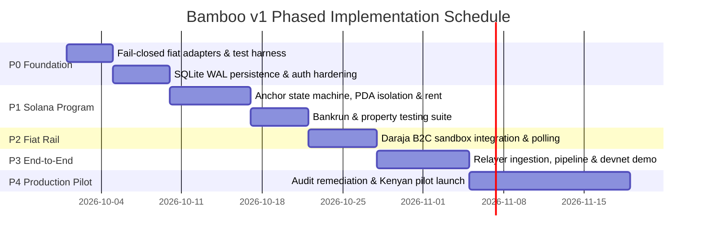

<!-- OPENWIKI:START -->
# Project Bamboo v1: Phased Implementation Plan & Security Architecture

## 1. Phased Roadmap & Milestones

Each milestone is strictly bounded, sequenced by technical dependency, and independently demonstrable.



---

### Phase P0: Core Hygiene & Fail-Closed Hardening
- **Objective:** Eliminate all mock security bypasses, make fiat verifiers fail-closed, and persist relayer data.
- **Tasks:**
  1. Refactor [`crates/bamboo-fiat/src/lib.rs`](../../crates/bamboo-fiat/src/lib.rs): Remove dummy success returns (`amount_fiat: 0.0`) and substring checks (`contains("PAID")`). Enforce typed errors on unverified callbacks.
  2. Refactor [`crates/bamboo-relayer/src/db.rs`](../../crates/bamboo-relayer/src/db.rs): Replace `new_in_memory()` with file-backed SQLite WAL database (`/var/data/bamboo/relayer.db`). Implement balanced double-entry accounting where `accounts.balance` is updated atomically.
  3. Delete insecure `POST /orders/settle` endpoint from [`crates/bamboo-relayer/src/main.rs`](../../crates/bamboo-relayer/src/main.rs).
- **Definition of Done:** `cargo test --workspace` passes with zero in-memory stubs and zero fail-open logic.
- **Test Evidence:** Integration test confirming that invalid proofs return `Err(FiatError::InvalidRecipient)`.

---

### Phase P1: Solana Escrow Program v1
- **Objective:** Build and verify the squattable-free, rent-reclaiming Anchor escrow program.
- **Tasks:**
  1. Implement maker-isolated PDA seeds `[b"order", maker, nonce.to_le_bytes()]`.
  2. Implement binary on-chain order ID derivation matching `bamboo-core`.
  3. Implement five-state FSM: `Locked`, `SettlementRequested`, `Disputed`, `Finalized`, `Refunded`.
  4. Enforce duration bounds ($900\text{s} \le D \le 604{,}800\text{s}$), fee ceiling ($\le 25\text{ bps}$), and settlement cutoff ($t \le \text{expiry} - W$).
  5. Add explicit account closing (`close = maker`) to reclaim rent lamports on terminal states.
- **Definition of Done:** Anchor program deployed to localnet and devnet; full test suite passing under `solana-program-test` / `bankrun`.
- **Test Evidence:** Automated test run demonstrating that front-running order creation fails and expiration refund executes without maker signature.

---

### Phase P2: Safaricom Daraja B2C Integration
- **Objective:** Connect the fiat adapter to Safaricom's official Daraja B2C gateway.
- **Tasks:**
  1. Implement OAuth token generation and RSA PKCS#1 v1.5 security credential encryption.
  2. Implement HTTP POST to `/mpesa/b2c/v1/paymentrequest`.
  3. Build webhook listener for `ResultURL` with payload validation and receipt extraction.
  4. Implement transaction status query polling fallback (`/mpesa/transactionstatus/v1/query`).
- **Definition of Done:** Successfully disburse test KES to a Daraja sandbox phone number and capture confirmed receipt.
- **Test Evidence:** Integration test logs showing end-to-end sandbox B2C disbursement and receipt confirmation.

---

### Phase P3: End-to-End Devnet Integration
- **Objective:** Connect all components into an autonomous end-to-end settlement pipeline.
- **Tasks:**
  1. Implement Solana WebSocket event listener with `finalized` commitment in `bamboo-relayer`.
  2. Connect event listener to M-Pesa disbursement worker and SQLite WAL ledger.
  3. Implement automated `request_settlement` and `finalize` cron pipeline.
  4. Build automated failure recovery on daemon startup.
- **Definition of Done:** An end-to-end off-ramp transaction executes autonomously on Solana Devnet and Daraja Sandbox: Maker locks USDC $\to$ Relayer disburses KES $\to$ Escrow finalizes.
- **Test Evidence:** Transaction signatures on Solana Explorer and SQLite journal records verifying zero balance drift.

---

### Phase P4: Hardening, External Audit & Pilot Launch
- **Objective:** Prepare infrastructure and legal compliance for a production pilot in Kenya.
- **Tasks:**
  1. Contract third-party Solana security audit firm (e.g. OtterSec, Neodyme, or Kudelski).
  2. Complete Safaricom production B2C shortcode onboarding and IP whitelisting.
  3. Deploy reference relayer daemon on hardened Linux host with HSM/KMS key protection.
  4. Execute limited pilot: 10,000 USDC volume cap with 500 USDC maximum ticket size.
- **Definition of Done:** Clean audit report with all high/medium findings resolved; live KES disbursements executing to pilot users.

---

## 2. Multi-Layer Testing Strategy

```
+-------------------------------------------------------------+
|                      E2E System Tests                       |
|           (Solana Devnet + Safaricom Sandbox Rail)          |
+-------------------------------------------------------------+
|                 Failure-Injection & Fuzzing                 |
|       (Dropped Callbacks, RPC Timeouts, Mempool Race)       |
+-------------------------------------------------------------+
|                     Anchor Program Tests                    |
|      (bankrun: State Transitions, Cutoffs, Rent Refunds)    |
+-------------------------------------------------------------+
|                     Unit & Property Tests                   |
|   (Preimage Stability, Double-Entry Balance, PDA Off-Curve) |
+-------------------------------------------------------------+
```

### 1. Unit & Property Tests (`cargo test`)
- **Order ID Preimage Invariance:** Assert that `bamboo-core::compute_canonical_order_id` matches on-chain test vectors byte-for-byte.
- **Double-Entry Invariants:** Property-based testing with `proptest` asserting that $\sum \text{Debits} == \sum \text{Credits}$ across 10,000 random transaction sequences.
- **PDA Off-Curve Property:** Assert that all derived order PDAs fail Edwards decompression.

### 2. Program Tests (`anchor test` / `bankrun`)
- Positive tests: Full lifecycle (`Locked` $\to$ `SettlementRequested` $\to$ `Finalized`).
- Negative tests: Settle after $\text{expiry} - W$; dispute after $W$; fee $> 25$ bps; duration $< 900$s.
- Rent tests: Assert that order PDA and vault token account lamports return to maker upon finalization and refund.

### 3. Failure-Injection Tests
- **Callback Drop Simulation:** Drop Daraja `ResultURL` webhook and verify that the relayer status-query poller recovers the receipt within 120 seconds.
- **Solana RPC Outage:** Sever RPC network connectivity mid-order, reconnect, and verify that the backfill loop resumes pending orders without duplicate fiat payments.

---

## 3. Threat Model & Security Plan

| Threat Vector | Attack Scenario | Protocol Mitigation |
|---|---|---|
| **Order ID Squatting** | Attacker front-runs victim's lock in mempool with 1 wei to make victim revert. | **Mitigated:** Order PDAs are partitioned by maker pubkey: `seeds = ['order', maker, nonce]`. |
| **Duration=0 Double-Dip** | Maker locks duration=0, receives fiat, immediately claims refund. | **Mitigated:** Contract enforces `duration >= 900` seconds; `request_settlement` must be called before $\text{expiry} - W$. |
| **Relayer Theft (Model A)** | Relayer calls settlement without paying fiat. | **Mitigated:** Maker has an un-bypassable 30-minute window ($W$) to call `dispute`, freezing funds on-chain. |
| **Maker Fraud (False Dispute)** | Maker receives fiat, then calls `dispute` to block relayer payout. | **Mitigated:** Disputed funds are frozen for 7 days (`DISPUTE_TIMEOUT`). Relayer holds legal M-Pesa receipt with recipient phone number for off-chain recovery. |
| **Rainbow Table De-Anonymization** | Attacker brute-forces on-chain phone hashes. | **Mitigated:** 32-byte cryptographic salt generated by client provides 256 bits of entropy. |
| **Key Compromise** | Attacker compromises relayer hot wallet. | **Mitigated:** Relayer hot wallet holds only daily operational float ($<\$5{,}000$); main treasury held in multi-sig cold storage. |

---

## 4. Regulatory & Compliance Checklist (Kenya Focus)

> **Notice:** The following checklist constitutes engineering and operational planning, NOT legal advice. Formal engagement with licensed Kenyan legal counsel is mandatory prior to mainnet launch.

1. **VASP Act 2025 Compliance:** Assess whether operating an off-ramp payout relayer requires a Virtual Asset Service Provider license under the Central Bank of Kenya (CBK) or Capital Markets Authority (CMA) regulations gazetted on 22 July 2026.
2. **Data Protection Act 2019:** Comply with the Office of the Data Protection Commissioner (ODPC) regarding storage and transmission of Kenyan consumer phone numbers (personal identifiable information).
3. **Safaricom Merchant Agreement:** Adhere to Safaricom's B2C acceptable use policy and anti-money laundering terms.

---

## 5. Risk Register

| Risk | Likelihood | Impact | Mitigation Strategy |
|---|---|---|---|
| **Safaricom API Outage / Callback Drop** | Medium | Medium | Automated status polling fallback; retry queue with exponential backoff. |
| **Safaricom Account Float Depletion** | Medium | High | Hard limits on order volume; automatic quote rejection when float $< \text{KES }100{,}000$. |
| **Solana RPC Congestion During Peak Drops** | High | Low | Use dedicated, staked RPC providers (e.g. Helius, Triton) with dynamic priority fees. |
| **Regulatory Freeze by Central Bank** | Low | High | Operate through a licensed Kenyan payment aggregator or local corporate partner. |
| **False Dispute by Malicious Maker** | Medium | Medium | 7-day freeze window allows off-chain mediation; phone number identity bound to Safaricom national ID. |

---

## 6. Effort Estimates & Assumptions

| Phase | Milestone | Engineering Days (Range) | Assumptions |
|---|---|---|---|
| **P0** | Foundation & Fiat Hardening | 5 – 8 days | Single engineer working across Rust crates and SQLite WAL schema. |
| **P1** | Solana Anchor Program v1 | 8 – 12 days | Uses Anchor 0.30+; comprehensive bankrun test coverage. |
| **P2** | Daraja Sandbox Integration | 5 – 7 days | Safaricom developer portal sandbox account available immediately. |
| **P3** | Relayer Daemon & Devnet E2E | 8 – 14 days | Dedicated Solana devnet node access; full state machine reconciliation. |
| **P4** | Hardening & Production Pilot | 14 – 21 days | Excludes external audit lead time (audit requires 2–4 calendar weeks). |
| **Total** | **Full v1 Delivery** | **40 – 62 engineering days** | Assumes 1 senior systems/Solana engineer and 1 backend/integration engineer. |

<!-- OPENWIKI:END -->
