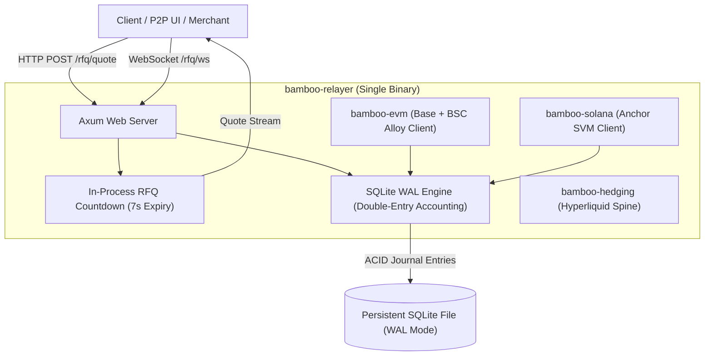

<!-- OPENWIKI:START -->
# Unified Host Daemon (`bamboo-relayer`)

> [!NOTE]
> **Status: v1 differs — see [docs/plan/](../plan/00-overview.md)**  
> Bamboo v1 uses a single reference relayer operated by the protocol team with file-backed SQLite WAL persistence, not a multi-node open marketplace or SurrealDB. See [13-relayer-daemon.md](../plan/13-relayer-daemon.md) and [14-ledger.md](../plan/14-ledger.md).

The off-chain backbone of Project Bamboo is compiled as a single binary **Rust Axum daemon** ([`crates/bamboo-relayer/src/main.rs`](../../crates/bamboo-relayer/src/main.rs)) designed for zero-cloud, self-hosted deployment by independent protocol node operators.



---

## Architectural Pillars

### 1. 7-Second RFQ Countdown Engine
Cross-chain currency conversion quotes must balance price certainty against market volatility. The daemon provides:
* **7-second deterministic countdown windows** (`RFQ_COUNTDOWN_SECONDS = 7`).
* Millisecond timestamping and automatic quote cache invalidation.
* Real-time heartbeat and streaming quotes over WebSockets (`/rfq/ws`).

### 2. ACID Double-Entry Ledger (SQLite in WAL Mode)
To ensure zero financial discrepancy, double-entry bookkeeping rules are enforced at database transaction boundaries:
* **Write-Ahead Logging (WAL)**: Enabled via `PRAGMA journal_mode = WAL; PRAGMA synchronous = NORMAL;`, ensuring high write concurrency without locking reads.
* **Balanced Journal Entries**: Every escrow settlement creates dual debit and credit ledger rows:
  - Debit: `ESCROW_VAULT`
  - Credit: `SETTLEMENT_PAYOUT` (recipient transfer)
  - Credit: `RELAYER_FEE_POOL` (relayer revenue, capped at 25 bps)

```sql
INSERT INTO journal_entries (id, order_id, debit_account, credit_account, amount, timestamp, description)
VALUES (?, ?, 'ESCROW_VAULT', 'SETTLEMENT_PAYOUT', ?, ?, 'Escrow payout to maker recipient');
```

### 3. Protocol Fee Ceiling Enforcement
The host daemon checks that relayer fee percentages strictly comply with the global ceiling:
$$\text{host\_fee\_bps} \le 25 \quad (0.25\%)$$
Any attempt to claim or configure higher fee margins is rejected by the node.

### 4. API Endpoints
* `GET /health` – Node health, protocol fee ceiling check, and countdown parameter verification.
* `POST /rfq/quote` – Generates a cryptographically verifiable 7-second settlement quote.
* `GET /rfq/ws` – Full duplex WebSocket channel for live quotes and heartbeats.
* `POST /orders/settle` – Records settlement reconciliation into the double-entry accounting ledger.
<!-- OPENWIKI:END -->
