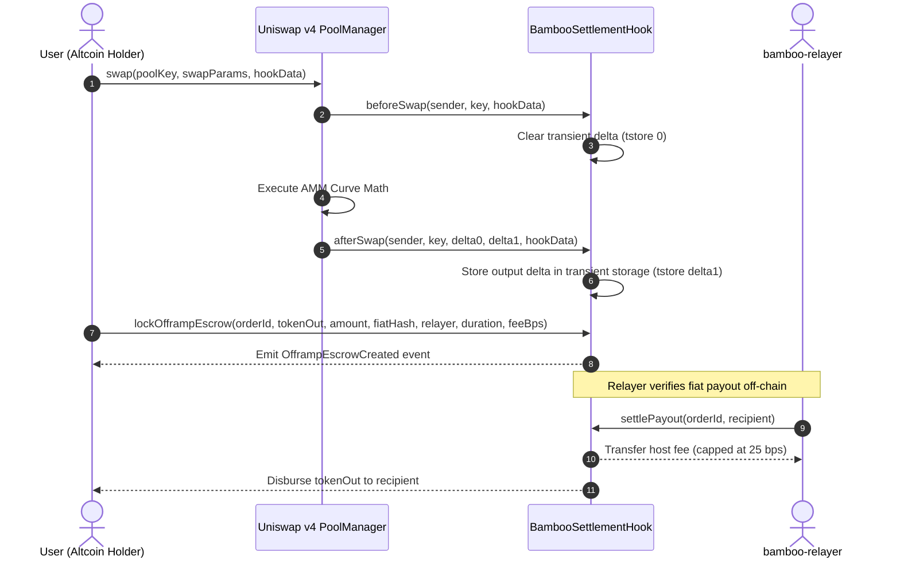

<!-- OPENWIKI:START -->
# Spoke 1: Base EVM (Uniswap v4 Hook)

The Base EVM spoke integrates directly into **Uniswap v4** as a custom hook contract ([`contracts/uniswap-hook/src/BambooSettlementHook.sol`](../../contracts/uniswap-hook/src/BambooSettlementHook.sol)), enabling users to off-ramp directly from any arbitrary token swap into fiat escrow.



---

## Architectural Invariants

### 1. Transient Storage Delta Capture (`TSTORE` / `TLOAD`)
Uniswap v4 utilizes EIP-1153 transient storage to maintain intermediate accounting states throughout transaction lifecycles without persisting them to permanent EVM storage, avoiding high gas penalties.

```solidity
bytes32 private constant TRANSIENT_DELTA_SLOT = keccak256("bamboo.transient.delta");

function _setTransientDelta(int128 delta) internal {
    assembly {
        tstore(TRANSIENT_DELTA_SLOT, delta)
    }
}

function _getTransientDelta() internal view returns (int128 delta) {
    assembly {
        delta := tload(TRANSIENT_DELTA_SLOT)
    }
}
```

### 2. Flash Accounting Integration
By integrating into the v4 `IPoolManager` lifecycle (`beforeSwap` and `afterSwap`), output deltas from multi-hop conversions (e.g., AERO -> WETH -> USDC) are captured inside the pool manager's delta balance and routed directly into escrow without redundant ERC-20 transfer overhead.

### 3. Protocol Fee Cap
Host relayer fees are strictly bounded:
```solidity
uint16 public constant MAX_HOST_FEE_BPS = 25; // 0.25% ceiling

if (hostFeeBps > MAX_HOST_FEE_BPS) revert HostFeeCeilingExceeded();
```

---

## Task & Build Configuration
Moon builds and caches the Foundry artifact directory `out/` as defined in [`contracts/uniswap-hook/moon.yml`](../../contracts/uniswap-hook/moon.yml).
<!-- OPENWIKI:END -->
