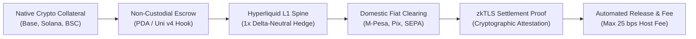

<!-- OPENWIKI:START -->
# Project Bamboo – Vision & Manifesto

> [!NOTE]
> **Status: v1 differs — see [docs/plan/](./plan/00-overview.md)**  
> Project Bamboo v1 implements a focused thin vertical slice (Solana USDC to M-Pesa KES via a single reference relayer). Architectural elements such as zkTLS proofs, multi-relayer markets, and delta-neutral hedging represent long-term roadmap targets and are not active in v1. See [00-overview.md](./plan/00-overview.md).

## 1. The Broken Last Mile of Crypto

Cryptocurrency networks have achieved sub-second transaction finality, fractions-of-a-cent gas fees, and multi-billion-dollar liquidity depth across chains like Solana, Base, and BNB Chain. Yet for 99% of global economic actors, **crypto remains trapped in an isolated digital reservoir**.

The moment a user or business attempts to move value between on-chain assets (SOL, ETH, USDC, BNB) and real-world domestic currency (M-Pesa in Kenya, Pix in Brazil, SEPA Instant in Europe):

1. **Predatory Spreads & Tariffs (3% to 7%):** Centralized exchanges, card processors, and crypto-fiat brokers charge exorbitant exchange rate markups and withdrawal fees. For emerging market users, this "crypto tax" destroys the economic advantage of blockchain rails.
2. **Custodial & Account Freeze Risk:** Traditional P2P desks (e.g., Binance P2P) force users into custody and leave them vulnerable to bank account freezes, fraudulent chargebacks, and arbitrary platform account lockouts.
3. **The Settlement Volatility Gap:** Moving from on-chain crypto to off-chain fiat is asynchronous—it takes 15 seconds to 15 minutes for bank networks to settle. During this window, price volatility in volatile collateral (SOL, ETH) exposes either the maker or the liquidity provider to massive delta risk.
4. **Bridge Vulnerabilities & Fragmented Liquidity:** Existing cross-chain off-ramps force users through lock-and-mint bridges, synthetic wrapped tokens, or high-slippage liquidity pools, introducing smart contract exploit risks.

---

## 2. The Bamboo Thesis: Open Routing & Settlement Flow

**Project Bamboo is the open, non-custodial routing and settlement protocol connecting on-chain liquidity directly to domestic banking and mobile money rails.**

Bamboo replaces centralized brokerage desks and custodial P2P marketplaces with a three-pillar architecture:

### Pillar 1: Native Multi-Spoke Execution Without Bridges
Bamboo does not wrap or bridge assets across chains. Instead, users interact natively where their capital already lives:
*   On **Solana**, orders execute via isolated Anchor Program Derived Address (PDA) escrows composable with Jupiter DEX swaps.
*   On **Base**, orders route through a custom Uniswap v4 Hook utilizing transient storage (`TSTORE`/`TLOAD`) and flash accounting.
*   On **BNB Chain**, orders settle through an optimized native BEP-20 / BNB escrow designed for high-velocity emerging market retail volume.

### Pillar 2: The Delta-Neutral Clearing Spine
To completely eliminate the price volatility risk inherent in volatile collateral during off-ramping, Bamboo routes order telemetry through `bamboo-hedging`. 
The instant an order locks on-chain, an automated **1x short perp position is opened on the Hyperliquid L1 order book**. This freezes the exact USD purchasing power of the collateral to 0 basis points of slippage until the fiat transfer clears.

### Pillar 3: Cryptographic Verification (zkTLS) & Fair Fees
Settlement is attested through domestic banking callbacks or zero-knowledge TLS (`zkTLS`) session proofs that verify bank transfer receipts cryptographically without revealing private identity data. 
Bamboo hardcodes an algorithmic fee ceiling of **`MAX_HOST_FEE_BPS = 25` (0.25%)**, ensuring that protocol relayers operate on razor-thin, competitive routing margins rather than exploitative spreads.

---

## 3. Guiding Principles

1. **Non-Custodial by Construction:** No centralized wallet, relayer key, or foundation multisig ever takes custody of user deposits. Collateral is locked exclusively in verifiable smart contract escrows.
2. **Zero Delta Risk:** Collateral volatility must be hedged programmatically at execution, never absorbed speculatively.
3. **Local Rails First:** The protocol interfaces directly with the dominant domestic payment infrastructure of each target geography (Safaricom M-Pesa in East Africa, Central Bank Pix in Brazil, SEPA Instant in Europe) rather than forcing synthetic card rails.
4. **Transparent Economics:** Fees are explicitly capped, deterministic, and visible on-chain before order commitment.
<!-- OPENWIKI:END -->
